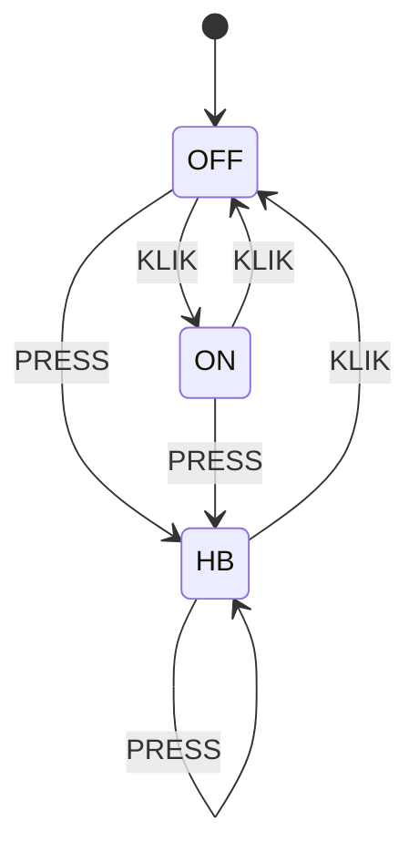
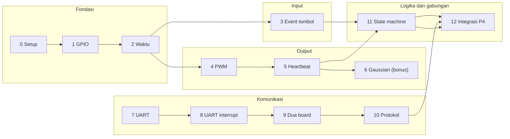

<div align="center">

# ⚡ Jalur Latihan STM32: Dari Blink LED sampai UART Dua Board

**Persiapan hands-on untuk Penugasan P4: komunikasi UART antar dua STM32 Blue Pill (STM32F103C8T6)**


</div>

> [!NOTE]
> Repositori ini adalah **modul belajar**, bukan kunci jawaban. Setiap level mengajarkan satu kemampuan kecil lewat konsep, hitungan, latihan, dan cek mandiri. Kode lengkap P4 sengaja tidak disertakan: tujuannya kamu bisa mengerjakannya sendiri.

## 🎯 Target akhir

Dua board Blue Pill terhubung lewat UART. **Tombol di satu board mengontrol LED di board lainnya, dua arah.** LED punya tiga state:



| Aksi | Definisi | Efek |
|---|---|---|
| **KLIK** | tombol ditahan $T \le 1$ s | toggle ON/OFF, atau keluar dari HB |
| **PRESS** | tombol ditahan $T > 1$ s | masuk mode heartbeat (breathing) dengan periode $T$ |


## 🗺️ Peta belajar

P4 terlihat besar, tetapi hanya gabungan dari lima kemampuan kecil. Tiap level melatih satu kemampuan, lalu digabung di akhir.



| Level | Topik | Kemampuan untuk P4 | Perkiraan waktu |
|---:|---|---|---|
| 0 | [Persiapan dan toolchain](docs/00-persiapan.md) | project, clock, flash, debug | 1 jam |
| 1 | [GPIO input dan output](docs/01-gpio.md) | baca tombol, nyalakan LED, deteksi tepi | 1,5 jam |
| 2 | [Waktu tanpa memblokir CPU](docs/02-waktu.md) | `HAL_GetTick`, ukur durasi tekan | 1,5 jam |
| 3 | [Event tombol: debounce dan interrupt](docs/03-event-tombol.md) | menghasilkan KLIK/PRESS + T | 2 jam |
| 4 | [PWM untuk kecerahan LED](docs/04-pwm.md) | `led_set_brightness()` | 1,5 jam |
| 5 | [Heartbeat linear](docs/05-heartbeat.md) | breathing periode $T$, non-blocking | 2 jam |
| 6 | [Gaussian (bonus)](docs/06-gaussian.md) | kurva lonceng, lookup table | 1,5 jam |
| 7 | [UART dasar](docs/07-uart.md) | kirim/terima, baud rate, terminal | 2 jam |
| 8 | [UART dengan interrupt](docs/08-uart-interrupt.md) | terima per byte, ring buffer | 2 jam |
| 9 | [Dua board saling terhubung](docs/09-dua-board.md) | wiring, GND bersama, firmware simetris | 1,5 jam |
| 10 | [Merancang protokol pesan](docs/10-protokol.md) | frame, checksum, parser | 2,5 jam |
| 11 | [State machine LED](docs/11-state-machine.md) | OFF/ON/HB sesuai tabel | 2 jam |
| 12 | [Integrasi P4](docs/12-integrasi-p4.md) | gabungan, uji, bonus | 3 jam |

Perkiraan waktu hanyalah patokan kasar. Lebih baik lambat tapi paham.

### Pemetaan kebutuhan P4 ke level

| Kebutuhan di dokumen P4 | Dilatih di |
|---|---|
| Tombol dengan klasifikasi $T \le 1$ s dan $T > 1$ s | Level 2, 3 |
| LED tiga state OFF/ON/HB | Level 11 |
| Heartbeat linear periode $T$ | Level 4, 5 |
| Heartbeat distribusi normal (bonus) | Level 6 |
| Komunikasi UART antar 2 STM32 | Level 7, 8, 9 |
| Kontrol dua arah (bidirectional) | Level 9, 12 |
| Format pesan yang andal | Level 10 |

## 🔁 Cara belajar di setiap level

1. **Baca konsep dulu**, tanpa menyentuh board.
2. **Tebak hasilnya** sebelum menjalankan kode. Menebak lalu salah adalah cara belajar tercepat.
3. **Kerjakan latihan** berurutan (A, B, C, ...).
4. **Aturan 15 menit:** buka petunjuk (`▶ Petunjuk`) hanya setelah mencoba sendiri minimal 15 menit. Petunjuknya bertingkat: mulai dari yang paling samar.
5. **Cek pemahaman** di akhir level. Jawabannya tersembunyi; tulis dulu jawabanmu.
6. **Commit** hasilnya (lihat [alur Git](#-memakai-fitur-github-untuk-belajar)).

> [!TIP]
> Kalau macet lebih dari satu jam, jangan menambah kode. Kecilkan masalahnya: uji satu bagian saja, tulis apa yang kamu harapkan dan apa yang terjadi, lalu tanyakan ke mentor beserta kodenya.

## 🧰 Alat dan bahan

| Item | Jumlah | Catatan |
|---|---:|---|
| STM32 Blue Pill (F103C8T6) | 2 | satu untuk Level 0–8, dua untuk Level 9–12 |
| ST-Link V2 | 1 | flash dan debug lewat SWD |
| Push button | 2 | satu per board |
| LED 5 mm | 2 | satu per board, plus yang bawaan PC13 |
| Resistor 330 Ω | 2 | seri dengan LED |
| Breadboard + kabel jumper | secukupnya | |
| USB-TTL **3,3 V** (CP2102/CH340) | 1 | opsional, tetapi sangat membantu untuk Level 7–10 |

## 📌 Rencana pin (dipakai di seluruh level)

| Fungsi | Pin | Level |
|---|---|---|
| Tombol (ke GND, pull-up internal) | **PA0** | 1 dst. |
| LED sederhana (ON/OFF) | PA5 | 1–3 |
| LED PWM (TIM1_CH1) | **PA8** | 4 dst. |
| LED indikator debug (active-low) | PC13 | semua |
| UART TX / RX (USART1) | **PA9 / PA10** | 7 dst. |

## 📁 Struktur repositori

```text
.
├── README.md                  ← kamu di sini
├── docs/
│   ├── 00-persiapan.md … 12-integrasi-p4.md   ← satu file per level
│   ├── cheatsheet-hal.md      ← kumpulan fungsi HAL dan dasar C
│   └── troubleshooting.md     ← daftar masalah umum dan cara memeriksanya
├── exercises/                 ← kerangka kode (skeleton) dengan TODO
├── assets/                    ← gambar penjelas
└── .github/ISSUE_TEMPLATE/    ← template checklist per level
```

## ✅ Pelacak progres

Salin daftar ini ke catatanmu, atau jadikan Issue (lihat bawah) agar kotaknya bisa dicentang langsung di GitHub.

- [ ] Level 0: LED PC13 berkedip, 20 kedipan ≈ 20 detik
- [ ] Level 1: tombol mengontrol LED, deteksi tepi dipahami
- [ ] Level 2: dua tugas berjalan bersamaan tanpa `HAL_Delay`
- [ ] Level 3: satu tekanan = tepat satu event, durasi akurat
- [ ] Level 4: `led_set_brightness()` bekerja 0–100%
- [ ] Level 5: heartbeat periode $T$ non-blocking
- [ ] Level 6 (bonus): Gaussian dengan lookup table
- [ ] Level 7: echo UART ke laptop, baud mismatch dipahami
- [ ] Level 8: terima via interrupt, ring buffer lolos uji
- [ ] Level 9: dua board saling bicara dua arah
- [ ] Level 10: parser menolak frame rusak dan pulih sendiri
- [ ] Level 11: enam skenario state machine lolos pada satu board
- [ ] Level 12: P4 lolos matriks uji dua arah

## 🐙 Memakai fitur GitHub untuk belajar

**1. Satu commit per latihan.** Pesan commit yang jelas membuatmu bisa kembali ke versi yang pernah jalan:

```bash
git add .
git commit -m "level-03: button event KLIK/PRESS dengan debounce 20 ms"
git tag level-03-done
```

**2. Satu Issue per level.** Buat Issue baru dengan template **Level checklist** (folder `.github/ISSUE_TEMPLATE`). Kotak centang di Issue bisa diklik langsung, dan progresnya muncul sebagai bar di daftar Issue.

**3. Project board.** Buat GitHub Project (Board) dengan kolom `Belum`, `Sedang`, `Selesai`, lalu tarik Issue per level ke sana.

**4. Catatan eksperimen.** Tulis hasil eksperimenmu (misalnya jumlah bouncing per 20 tekanan) di komentar Issue. Itu bahan bagus untuk laporan P4.

**5. Mermaid, tabel, dan rumus** di repositori ini dirender otomatis oleh GitHub. Kamu bisa memakai cara yang sama untuk dokumentasi P4-mu.

> [!IMPORTANT]
> Jangan commit folder `Debug/` dan `Release/` hasil build CubeIDE. Buat file `.gitignore` seperti yang dijelaskan di [Level 0](docs/00-persiapan.md#7-menyimpan-pekerjaan-dengan-git).

## 📚 Rujukan

- Modul 4: *Dari Kode Pertama hingga Percakapan* (materi utama)
- Slide Pelatihan Lanjutan UKM Robotik ITS: protokol komunikasi, UART/I2C/SPI/CAN
- Penugasan P4: Komunikasi UART antara 2 STM32 Blackpill
- RM0008 (Reference Manual STM32F1) dan datasheet STM32F103x8 dari ST

**Mulai dari sini →** [Level 0: Persiapan dan toolchain](docs/00-persiapan.md)
