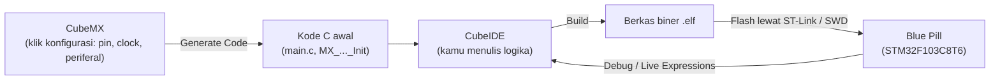

# Level 0: Persiapan dan Toolchain

[← Beranda](../README.md) · [Level 1: GPIO →](01-gpio.md)

> [!NOTE]
> Tujuan level ini: memastikan **rantai alat** bekerja dari ujung ke ujung (kode → kompilasi → flash → hardware) dan **clock** sudah benar. Kalau dua hal ini salah, semua level berikutnya akan membingungkan.

## Tujuan belajar

- [ ] Membuat project STM32F103C8T6 di CubeMX dengan clock 72 MHz
- [ ] Memahami aturan blok `USER CODE` supaya kodemu tidak terhapus
- [ ] Menjalankan alur kerja build → flash → debug
- [ ] Memakai *Live Expressions* untuk mengintip isi variabel

---

## 1. Konsep: apa yang sebenarnya terjadi di balik layar

Kamu memakai **dua alat** dari ST yang bekerja berurutan:



**Library HAL** (*Hardware Abstraction Layer*) adalah kumpulan fungsi C buatan ST, seperti `HAL_GPIO_WritePin`. Di dalamnya, fungsi itu hanya menulis ke register yang sama dengan yang kamu lihat di Modul 4 subbab 3.3 (*memory-mapped I/O*). HAL bukan sihir; ia hanya membungkus pekerjaan register agar lebih aman dan portabel.

### Mengapa clock harus benar

Semua pewaktuan di STM32 (delay, PWM, baud rate UART) diturunkan dari clock. Rantainya untuk Blue Pill:

$$ f_{HSE} = 8\ \text{MHz} \xrightarrow{\ \times 9\ (\text{PLL})\ } f_{SYSCLK} = 72\ \text{MHz} $$

Jika kamu menyetel clock berbeda dari yang kamu kira, maka `HAL_Delay(500)` tidak lagi 500 ms nyata, dan baud rate UART meleset. Itulah sebabnya Level 0 mengujinya dengan stopwatch.

---

## 2. Rangkaian dasar di breadboard

Pasang Blue Pill di breadboard, lalu hubungkan pin **G (GND)** ke jalur biru (rail negatif). Semua komponen yang butuh GND diambil dari rail itu.

```text
PA0 ───┬─── [tombol] ─── GND            (pull-up internal STM32 menarik PA0 ke 3,3 V)

PA5 ─── [330 Ω] ─── (+) LED (−) ─── GND   (kaki panjang LED = anoda = sisi resistor)
```

> [!WARNING]
> Push button 4 kaki punya **dua pasang kaki yang sudah tersambung di dalam**. Pasang kabelmu pada kaki yang **bersilangan (diagonal)**. Kalau dua kabel jatuh pada pasangan kaki yang sama, tombol tidak pernah memutus atau menyambung apa pun.

LED bawaan board (PC13) tersambung ke 3,3 V dan menyala jika PC13 **LOW**. Itu disebut *active-low*. LED eksternalmu di atas *active-high*: menyala jika pin **HIGH**.

---

## 3. Membuat project di CubeMX

Ikuti urutan ini. Setiap langkah berakar dari Bab II Modul 4.

| # | Menu | Pengaturan | Alasan |
|--:|---|---|---|
| 1 | *Start My project from MCU* | pilih **STM32F103C8Tx** | chip Blue Pill |
| 2 | System Core → **SYS** | Debug = **Serial Wire** | tanpa ini, kamu terkunci dari flash/debug lewat SWD |
| 3 | System Core → **RCC** | HSE = **Crystal/Ceramic Resonator** | memakai kristal 8 MHz di board |
| 4 | **Clock Configuration** | PLL Source = HSE, PLLMul = **×9**, System Clock Mux = **PLLCLK**, HCLK = **72 MHz** | kecepatan maksimum |
| 5 | Clock Configuration | APB1 prescaler = **/2** | batas bus APB1 = 36 MHz |
| 6 | Pinout | **PC13** → `GPIO_Output` | LED bawaan |
| 7 | Project Manager | Toolchain/IDE = **STM32CubeIDE**, beri nama project | |
| 8 | — | klik **GENERATE CODE** lalu **Open Project** | |

> [!CAUTION]
> Jika SYS Debug dibiarkan *No Debug*, chip tidak bisa diprogram ulang lewat SWD. Kamu harus memakai trik pin BOOT0 untuk memulihkannya. Selalu periksa langkah 2 sebelum Generate Code.

> [!TIP]
> **USB (CDC) boleh dimatikan.** Modul 4 mengaktifkan USB sebagai contoh, tetapi P4 memakai UART lewat PA9/PA10. Mematikan USB menghilangkan satu sumber kerumitan (USB butuh clock 48 MHz tepat). Kalau project-mu sudah memakai USB, tidak masalah untuk Level 0–6.

---

## 4. Aturan emas: blok `USER CODE`

CubeMX membuat ulang berkas yang dihasilkannya setiap kali kamu menekan Generate Code. **Hanya kode di dalam blok komentar `USER CODE BEGIN ... END` yang dipertahankan.**

```c
/* USER CODE BEGIN WHILE */
while (1)
{
    HAL_GPIO_TogglePin(GPIOC, GPIO_PIN_13);   // ✅ aman: di dalam blok
    HAL_Delay(500);
    /* USER CODE END WHILE */

    /* USER CODE BEGIN 3 */
}
/* USER CODE END 3 */
```

```c
MX_GPIO_Init();
HAL_GPIO_TogglePin(GPIOC, GPIO_PIN_13);       // ❌ di luar blok: akan terhapus saat Generate Code
/* USER CODE BEGIN 2 */
```

Peta blok yang akan paling sering kamu pakai:

| Blok | Isi yang cocok |
|---|---|
| `USER CODE BEGIN Includes` | `#include` tambahan |
| `USER CODE BEGIN PV` | variabel global (*private variables*) |
| `USER CODE BEGIN PFP` | prototipe fungsi |
| `USER CODE BEGIN 0` | definisi fungsi dan callback buatanmu |
| `USER CODE BEGIN 2` | kode **sekali jalan** sebelum loop (mulai PWM, mulai UART) |
| `USER CODE BEGIN WHILE` | kode yang **berulang** di super-loop |

---

## 5. Alur kerja harian

1. Tulis kode di CubeIDE.
2. **Build:** `Ctrl+B`. Baca pesan error dari yang paling atas.
3. **Flash dan jalankan:** `Run` (`Ctrl+F11`), atau **Debug** (`F11`) kalau ingin berhenti di titik tertentu.
4. Ubah konfigurasi pin/periferal? Buka berkas `.ioc` → ubah → **Generate Code** → build ulang.

### Mengintip variabel dengan *Live Expressions*

Saat sesi Debug berjalan: menu **Window → Show View → Live Expressions**, klik `Add new expression`, ketik nama variabel global. Nilainya diperbarui terus-menerus. Ini jauh lebih cepat daripada menebak lewat kedipan LED.

> [!TIP]
> Variabel yang berubah di dalam interrupt harus bertipe `volatile`, kalau tidak, kompiler bisa menyimpan nilainya di register dan Live Expressions tampak "beku". Penjelasannya ada di [Level 3](03-event-tombol.md).

---

## 6. Cara membaca dokumentasi HAL tanpa menghafal

Kamu tidak perlu hafal fungsi. Ada tiga kebiasaan yang cukup:

| Kebiasaan | Cara |
|---|---|
| **Autocomplete** | ketik `HAL_GPIO_` lalu `Ctrl+Space` |
| **Lihat isi/deklarasi** | tahan `Ctrl` lalu klik nama fungsi (atau `F3`) |
| **Baca header** | buka `stm32f1xx_hal_gpio.h`; deklarasi dan komentar fungsi ada di sana |

Hampir semua fungsi HAL mengikuti pola `HAL_<periferal>_<aksi>`, misalnya `HAL_GPIO_ReadPin`, `HAL_UART_Transmit`, `HAL_TIM_PWM_Start`. Lihat [cheatsheet](cheatsheet-hal.md).

---

## 7. Menyimpan pekerjaan dengan Git

Di folder workspace project CubeIDE:

```bash
git init
# salin .gitignore dari repositori ini (mengabaikan Debug/, Release/, dll.)
git add .
git commit -m "level-00: project awal F103C8T6, clock 72 MHz"
git tag level-00-done
```

---

## 🧪 Latihan

### 0A. Hello World: blink PC13

**Tujuan:** membuktikan toolchain bekerja.

1. Buat project sesuai tabel di atas.
2. Isi `while(1)` dengan:

   ```c
   HAL_GPIO_TogglePin(GPIOC, GPIO_PIN_13);
   HAL_Delay(500);
   ```
3. Build dan flash.

**Hasil yang diharapkan:** LED bawaan berkedip, satu kedipan penuh (menyala lalu mati) sekitar 1 detik.

<details>
<summary>▶ Petunjuk 1: LED tidak berkedip sama sekali</summary>

Buka `main.c`, lihat fungsi `MX_GPIO_Init()`. Harus ada `__HAL_RCC_GPIOC_CLK_ENABLE();` dan satu blok yang mengatur `GPIO_PIN_13`. Kalau tidak ada, PC13 belum dijadikan `GPIO_Output` di `.ioc`, atau Generate Code belum dijalankan ulang.

</details>

<details>
<summary>▶ Petunjuk 2: gagal flash / "No ST-LINK detected"</summary>

Periksa kabel SWD (SWDIO, SWCLK, GND, 3,3 V), pastikan jumper BOOT0 = 0, dan pastikan SYS Debug = Serial Wire di `.ioc`. Lihat [troubleshooting](troubleshooting.md).

</details>

### 0B. Uji clock dengan stopwatch

**Tujuan:** membuktikan clock 72 MHz benar, bukan menebak.

1. Biarkan kode 0A berjalan.
2. Nyalakan stopwatch di HP, lalu hitung **20 kedipan penuh**.

**Hasil yang diharapkan:** ≈ 20 detik (toleransi beberapa persen akibat hitungan manual).

<details>
<summary>▶ Petunjuk: kalau meleset jauh</summary>

Sebuah kedipan penuh = 2 kali `Toggle` = 2 × 500 ms = 1 s. Jika 20 kedipan memakan, misalnya, 40 detik atau 10 detik, periksa lagi setelan HSE dan PLL (×9) di tab *Clock Configuration*.

</details>

### 0C. Intip variabel dengan Live Expressions

1. Tambahkan variabel global di blok `USER CODE BEGIN PV`: `volatile uint32_t counter = 0;`
2. Di `while(1)`, tambahkan `counter++;` di dalam loop blink.
3. Jalankan mode Debug, tambahkan `counter` ke Live Expressions.

**Hasil yang diharapkan:** angka bertambah 1 tiap 500 ms.

---

## ✅ Checkpoint: lulus jika

- [ ] 20 kedipan penuh memakan sekitar 20 detik
- [ ] Kamu bisa menunjukkan di `main.c` mana saja yang aman ditulisi kode
- [ ] `counter` terlihat naik di Live Expressions

## ❓ Cek pemahaman

**1.** Kenapa SYS Debug harus diset ke *Serial Wire*?

**2.** Kamu menulis `HAL_Delay(100);` tepat di bawah `MX_GPIO_Init();` di luar blok `USER CODE`, lalu Generate Code. Apa yang terjadi pada baris itu?

**3.** Dengan HCLK = 72 MHz, berapa tick CPU dalam 1 ms?

<details>
<summary>▶ Kunci jawaban (tulis jawabanmu dulu)</summary>

1. Supaya pin SWDIO/SWCLK tetap aktif sebagai jalur debug, sehingga chip bisa diprogram dan di-debug lewat ST-Link setelah konfigurasi diterapkan.
2. Baris itu terhapus, karena berada di luar blok `USER CODE`.
3. $72\,000\,000 \times 0{,}001 = 72\,000$ tick.

</details>

---

[← Beranda](../README.md) · [Level 1: GPIO →](01-gpio.md)
