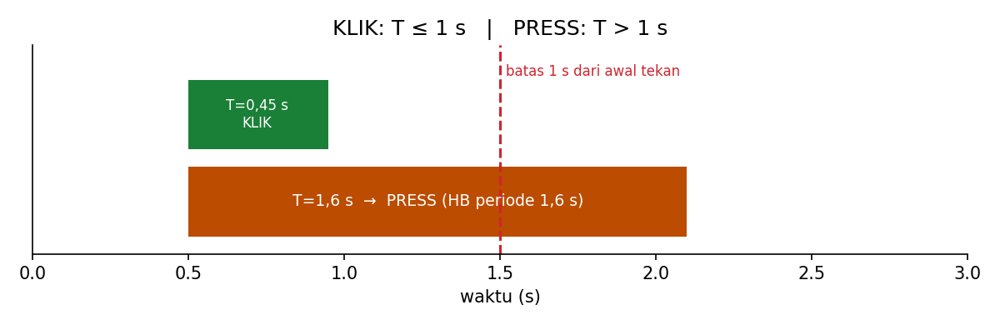

# Level 2: Waktu Tanpa Memblokir CPU

[← Level 1](01-gpio.md) · [Beranda](../README.md) · [Level 3: Event Tombol →](03-event-tombol.md)

> [!NOTE]
> Tujuan level ini: mengganti kebiasaan "menunggu" (`HAL_Delay`) dengan kebiasaan "mengecek jam" (`HAL_GetTick`). Di P4, satu board harus sekaligus mengamati tombol, membaca UART, dan menggerakkan LED. Itu mustahil kalau CPU sedang menunggu.

## Tujuan belajar

- [ ] Menjelaskan bedanya *blocking* dan *non-blocking*
- [ ] Memakai `HAL_GetTick()` untuk menjalankan tugas berkala
- [ ] Memahami kenapa `sekarang - mulai` aman dari overflow
- [ ] Mengukur durasi tekan tombol dan mengklasifikasikannya (KLIK/PRESS)

**Prasyarat:** [Level 1](01-gpio.md).

---

## 🧠 Konsep

### 1. Blocking vs non-blocking

`HAL_Delay(500)` menahan CPU di satu tempat selama 500 ms. Selama itu, program tidak bisa membaca tombol atau UART.

| | `HAL_Delay` (blocking) | Cek jam (non-blocking) |
|---|---|---|
| Analogi | menunggu air mendidih sambil memandangi panci | pasang timer di dapur, sambil mengerjakan hal lain |
| CPU saat menunggu | tidak bisa melakukan hal lain | tetap berputar mengerjakan tugas lain |
| Cocok untuk | demo sederhana | firmware yang mengerjakan banyak hal |

### 2. Dari mana waktu berasal: SysTick

Cortex-M punya penghitung kecil bernama **SysTick**. HAL mengaturnya agar menghasilkan interrupt tiap **1 ms**. Setiap interrupt menaikkan sebuah variabel penghitung. Fungsi `HAL_GetTick()` mengembalikan isi penghitung itu: **jumlah milidetik sejak board menyala**.

**Hitungan:** dengan HCLK 72 MHz, SysTick dimuat dengan:

$$ \text{reload} = \frac{72\,000\,000}{1000} = 72\,000\ \text{tick per ms} $$

### 3. Pola dasar: simpan waktu terakhir, tanya selisihnya

Setiap putaran loop, bertanya: "sudah berapa ms sejak terakhir kali?"

```c
uint32_t t_last = 0;

while (1)
{
    uint32_t now = HAL_GetTick();

    if (now - t_last >= 500)      // sudah 500 ms?
    {
        t_last = now;             // catat kapan terakhir
        HAL_GPIO_TogglePin(GPIOC, GPIO_PIN_13);
    }

    // CPU bebas mengerjakan hal lain di sini
}
```

### 4. Kenapa `now - t_last`, bukan `now >= t_last + 500`?

`HAL_GetTick()` bertipe `uint32_t` (maksimum $2^{32}-1 = 4\,294\,967\,295$). Setelah

$$ \frac{2^{32}\ \text{ms}}{86\,400\,000\ \text{ms/hari}} \approx 49{,}7\ \text{hari} $$

penghitung kembali ke 0 (**wrap-around**). Pengurangan unsigned tetap benar walau itu terjadi.

**Contoh:** `t_last = 4294967290`, lalu penghitung melewati batas dan `now = 10`.

$$ \text{now} - t_{last} = 10 - 4\,294\,967\,290 \equiv 16 \pmod{2^{32}} $$

Cek logikanya: dari 4294967290 menuju batas butuh 6 ms, lalu 10 ms lagi, total 16 ms. ✅ Sedangkan `now >= t_last + 500` akan salah karena `t_last + 500` ikut meluap.

> [!IMPORTANT]
> Selalu tulis pewaktuan sebagai **selisih** (`now - start`), tidak pernah sebagai perbandingan dua waktu mutlak. Kebiasaan ini akan dipakai terus di P4.

### 5. Tugas periodik: hindari *drift*

Ada dua cara memperbarui `t_last`:

| Cara | Efek |
|---|---|
| `t_last = now;` | simpel, tetapi kalau loop telat 3 ms, 3 ms itu hilang tiap siklus → periode melebar pelan-pelan (*drift*) |
| `t_last += period;` | menjaga irama jangka panjang tetap tepat, tapi kalau CPU tertunda lama bisa "mengejar" banyak siklus sekaligus |

Untuk LED kedip, keduanya cukup. Untuk heartbeat di Level 5, kamu akan memakai pola yang sedikit berbeda (fase).

### 6. Mengukur durasi tekan

Prinsipnya sama dengan Level 1 (deteksi tepi), ditambah stempel waktu:

```text
tepi turun (ditekan)   →  t_press = now
tepi naik  (dilepas)   →  T = now - t_press
```

Klasifikasi sesuai dokumen P4:

$$ \text{KLIK: } T \le 1000\ \text{ms} \qquad\qquad \text{PRESS: } T > 1000\ \text{ms} $$

> [!WARNING]
> Perhatikan batasnya: $T = 1000$ ms tepat adalah **KLIK** (karena ≤). Tulis kondisinya dengan `<=`, bukan `<`.



---

## 🧪 Latihan

### 2A. Blink PC13 tanpa `HAL_Delay`

**Aturan:** PC13 berkedip tiap 500 ms memakai pola di Konsep 3.

**Hasil yang diharapkan:** sama seperti Level 0, tetapi tanpa `HAL_Delay` di loop.

<details>
<summary>▶ Petunjuk</summary>

Simpan `t_last` di luar `while`. Di dalam loop: ambil `now`, bandingkan `now - t_last` dengan 500, dan perbarui `t_last` hanya ketika kondisi terpenuhi.

</details>

### 2B. Dua tugas bersamaan

**Aturan:** PC13 berkedip tiap 500 ms **dan** LED eksternal PA5 berkedip tiap 130 ms, bersamaan dan independen.

Kamu butuh **dua** variabel waktu terakhir (`t_last_a`, `t_last_b`).

**Hasil yang diharapkan:** dua LED berkedip dengan irama masing-masing, tidak saling mengganggu. Ini adalah bukti loopmu tidak lagi terblokir.

<details>
<summary>▶ Petunjuk</summary>

Satu `now = HAL_GetTick()` per putaran loop, lalu dua blok `if` terpisah, masing-masing dengan variabelnya sendiri.

</details>

### 2C. Klasifikasi tekan (polling)

**Aturan:** ukur durasi tekan tombol PA0 dengan deteksi tepi dan `HAL_GetTick`. Tampilkan hasilnya lewat PC13 (active-low):

| Hasil | Umpan balik |
|---|---|
| KLIK | PC13 berkedip **satu kali pendek** (±100 ms) |
| PRESS | PC13 menyala **satu kali panjang** (500 ms) |

Karena kamu belum boleh memakai `HAL_Delay` untuk umpan balik ini, tampilkan secara non-blocking: saat event terjadi, nyalakan LED dan catat `t_feedback = now`; matikan LED ketika `now - t_feedback >= durasi`.

**Hasil yang diharapkan:** tekan cepat → kedip pendek; tahan lama → kedip panjang.

<details>
<summary>▶ Petunjuk 1: kerangka pikir</summary>

Kamu butuh: `prev` (nilai pin sebelumnya), `t_press`, satu flag/variabel untuk "umpan balik sedang berjalan", dan `feedback_ms` (100 atau 500). Ada dua bagian terpisah di loop: (1) mendeteksi tepi dan menghitung `T`, (2) mengelola kapan LED umpan balik dimatikan.

</details>

<details>
<summary>▶ Petunjuk 2: yang harus dilakukan saat tepi turun dan tepi naik</summary>

Tepi turun: simpan `t_press = now`. Tepi naik: hitung `T = now - t_press`, bandingkan dengan 1000, pilih `feedback_ms`, nyalakan LED, simpan `t_feedback = now`.

</details>

### 2D. Uji batas

Tekan tombol dengan durasi sekitar **0,5 s**, **0,9 s**, **1,1 s**, dan **2 s** (pakai stopwatch HP atau hitung "satu seribu, dua seribu"). Catat hasil klasifikasi.

| Durasi | Seharusnya | Terbaca |
|---|---|---|
| ±0,5 s | KLIK | |
| ±0,9 s | KLIK | |
| ±1,1 s | PRESS | |
| ±2 s | PRESS | |

**Tantangan:** tambahkan `volatile uint32_t last_T_ms` dan pantau di Live Expressions. Bandingkan angka `T` dengan stopwatch.

---

## ✅ Checkpoint: lulus jika

- [ ] 2B berjalan mulus: dua LED, dua irama, tanpa `HAL_Delay`
- [ ] 2C membedakan tekan cepat dan tahan lama dengan benar
- [ ] Kamu bisa menjelaskan kenapa memakai `now - start`

## ❓ Cek pemahaman

**1.** Apa kelemahan `HAL_Delay(500)` di firmware yang harus membaca tombol dan UART sekaligus?

**2.** `t_last = 4294967000` dan `now = 200` (setelah wrap). Berapa `now - t_last` pada `uint32_t`?

**3.** Tombol ditahan tepat 1000 ms. KLIK atau PRESS?

<details>
<summary>▶ Kunci jawaban (tulis jawabanmu dulu)</summary>

1. CPU terhenti selama delay, sehingga tombol yang ditekan atau byte UART yang datang saat itu terlewat atau terlambat ditangani.
2. $200 - 4\,294\,967\,000 + 4\,294\,967\,296 = 496$ ms. (Dari 4294967000 ke batas butuh 296 ms, ditambah 200 ms.)
3. **KLIK**, karena definisinya $T \le 1$ s.

</details>

## ⚠️ Kesalahan umum

| Gejala | Penyebab |
|---|---|
| LED kedip tidak teratur | memanggil `HAL_GetTick()` berkali-kali dalam satu putaran dan membandingkan hasil yang berbeda; ambil `now` sekali |
| Klasifikasi terbalik di batas | memakai `<` bukan `<=` pada 1000 ms |
| Durasi aneh besar sekali | `T` dihitung sebagai `t_press - now` (terbalik); urutan harus `now - t_press` |

---

[← Level 1](01-gpio.md) · [Beranda](../README.md) · [Level 3: Event Tombol →](03-event-tombol.md)
