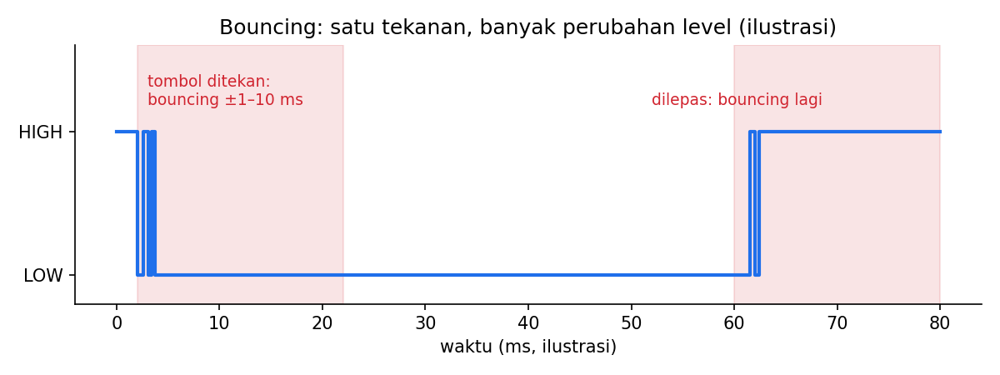
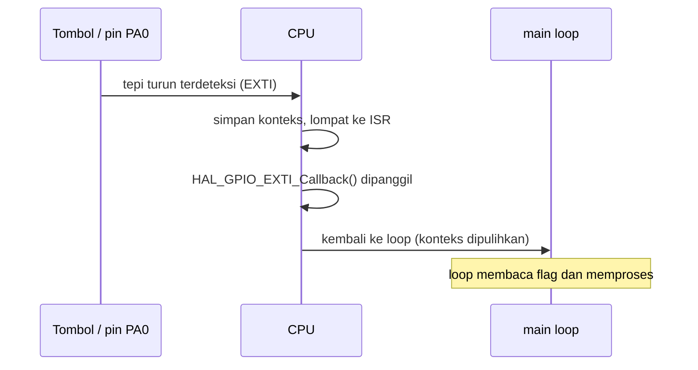

# Level 3: Event Tombol yang Rapi (Debounce dan Interrupt)

[← Level 2](02-waktu.md) · [Beranda](../README.md) · [Level 4: PWM →](04-pwm.md)

> [!NOTE]
> Tujuan level ini: menghasilkan **satu event bersih** per tekanan, lengkap dengan durasi $T$, dalam bentuk modul yang bisa dipakai ulang di P4.

## Tujuan belajar

- [ ] Menjelaskan *bouncing* dan dua cara menanganinya
- [ ] Mengonfigurasi interrupt eksternal (EXTI) pada kedua tepi
- [ ] Menulis callback interrupt yang singkat dan aman
- [ ] Membuat modul `button.c/.h` dengan API yang rapi

**Prasyarat:** [Level 2](02-waktu.md) (khususnya `HAL_GetTick` dan klasifikasi KLIK/PRESS).

---

## 🧠 Konsep

### 1. Bouncing

Kontak logam tombol memantul beberapa kali dalam beberapa milidetik ketika ditekan atau dilepas. Mikrokontroler cukup cepat untuk melihat **semua** pantulan sebagai tekanan terpisah.



Dua cara menanganinya, dan kita akan memakai **keduanya sekaligus**:

| Cara | Ide | Kelebihan |
|---|---|---|
| **Jendela waktu** | abaikan perubahan yang terjadi < ±20 ms setelah perubahan yang diterima sebelumnya | sederhana |
| **Pelacakan state** | simpan "tombol sedang ditekan atau tidak"; abaikan perubahan yang tidak mengubah state | tahan terhadap pantulan yang membaca level sama berulang |

### 2. Interrupt: hardware yang memanggilmu

Di Level 2, loop kamu bertanya terus ("sudah ditekan belum?"). Dengan **interrupt**, hardware memberi tahu saat pin berubah (Modul 4 subbab 3.5: seperti bel pintu). Alurnya:



Karena durasi tekan = jarak antara **dua tepi**, kita butuh interrupt pada **tepi turun dan tepi naik**.

### 3. Tiga aturan ISR/callback

> [!IMPORTANT]
> 1. **Singkat.** Catat waktu, set flag, selesai. Pekerjaan berat dikerjakan di `while(1)`.
> 2. **Jangan `HAL_Delay` di dalam callback.** Prioritas default SysTick lebih rendah dari EXTI, sehingga `HAL_Delay` di dalam ISR bisa membuat program hang selamanya.
> 3. **Variabel yang dibagi** antara ISR dan `main` harus `volatile`.

Kenapa `volatile`? Kompiler tidak melihat ISR dipanggil dari mana pun di `main`, sehingga ia mungkin menyimpan variabel di register dan tidak pernah membaca ulang dari memori (Modul 4 subbab 3.3).

### 4. Pola produsen–konsumen dengan flag

```text
ISR (produsen)                          main loop (konsumen)
──────────────                          ───────────────────
tepi turun: simpan t_press
tepi naik : hitung T, isi press_ms,     if (flag) {
            set flag = 1                    salin press_ms
                                            flag = 0
                                            proses event
                                        }
```

Pola ini aman untuk tombol karena event datang berjarak puluhan milidetik. (Untuk aliran data cepat seperti UART di Level 8, kita memakai ring buffer.)

### 5. Konfigurasi di CubeMX

1. Klik pin **PA0** → pilih `GPIO_EXTI0`.
2. System Core → **GPIO** → PA0: *GPIO mode* = **External Interrupt Mode with Rising/Falling edge trigger detection**, *Pull* = **Pull-up**.
3. System Core → **NVIC**: centang **EXTI line0 interrupt**.
4. Generate Code.

> [!NOTE]
> Nomor EXTI mengikuti **nomor pin**, bukan port: PA0 dan PB0 sama-sama memakai EXTI0. Kalau tombol dipindah ke pin lain, jalur EXTI dan baris NVIC-nya ikut berubah.

### 6. Contoh hitungan

| Peristiwa | `now` (ms) | Hasil |
|---|---:|---|
| Tepi turun | 1000 | `t_press = 1000` |
| Tepi naik | 1450 | $T = 1450 - 1000 = 450$ → **KLIK** |
| Tepi turun | 2000 | `t_press = 2000` |
| Tepi naik | 3300 | $T = 3300 - 2000 = 1300$ → **PRESS** |

---

## 🧩 Rancangan modul

Pisahkan logika tombol dari `main.c`. API yang kita tuju:

```c
typedef enum { BTN_EVT_NONE = 0, BTN_EVT_KLIK, BTN_EVT_PRESS } ButtonEvent;

void        button_init(void);                          // opsional: reset state
void        button_on_exti(uint16_t gpio_pin);          // dipanggil dari HAL_GPIO_EXTI_Callback
ButtonEvent button_poll(uint32_t *duration_ms);         // dipanggil dari main loop
```

`HAL_GPIO_EXTI_Callback` tetap berada di `main.c` (blok `USER CODE BEGIN 0`) dan hanya meneruskan ke `button_on_exti`. Kerangka berkas ada di [`exercises/level-03-button/`](../exercises/level-03-button/).

---

## 🧪 Latihan

### 3A. Lihat bouncing mentah lewat EXTI

**Aturan:** konfigurasikan EXTI (langkah 5). Di callback, cukup `edge_count++` (variabel `volatile`). Jangan melakukan apa pun yang lain.

```c
volatile uint32_t edge_count = 0;

void HAL_GPIO_EXTI_Callback(uint16_t GPIO_Pin)
{
    if (GPIO_Pin == GPIO_PIN_0)
    {
        edge_count++;
    }
}
```

Pantau `edge_count` di Live Expressions. Tekan dan lepas **10 kali**.

**Hasil yang diharapkan:** `edge_count` jauh lebih besar dari 20 (idealnya 20 tepi untuk 10 siklus). Selisihnya adalah bouncing yang kamu lihat langsung.

### 3B. Event bersih: state + jendela waktu

**Aturan:** ubah callback menjadi pembuat event. Kerangka pikirnya:

```c
volatile uint32_t t_press = 0;
volatile uint32_t press_ms = 0;
volatile uint8_t  event_ready = 0;
volatile uint8_t  pressed = 0;       // pelacakan state
static   uint32_t t_last_edge = 0;   // untuk jendela waktu

void HAL_GPIO_EXTI_Callback(uint16_t GPIO_Pin)
{
    if (GPIO_Pin != GPIO_PIN_0) return;

    uint32_t now = HAL_GetTick();
    if (/* (A) selisih dari t_last_edge < 20 ms → abaikan */) return;

    GPIO_PinState level = HAL_GPIO_ReadPin(GPIOA, GPIO_PIN_0);

    if (/* (B) level menunjukkan ditekan DAN state belum "pressed" */)
    {
        // catat awal tekan
    }
    else if (/* (C) level menunjukkan dilepas DAN state sedang "pressed" */)
    {
        // hitung durasi, set event_ready
    }
    // (D) perbarui t_last_edge di tempat yang tepat
}
```

Di `while(1)`: jika `event_ready`, salin `press_ms`, kosongkan flag, klasifikasikan KLIK/PRESS, dan beri umpan balik LED non-blocking seperti 2C.

**Hasil yang diharapkan:** satu tekanan = tepat satu event, termasuk tombol yang sedikit "kotor".

<details>
<summary>▶ Petunjuk 1: logika level</summary>

Dengan pull-up, **ditekan = LOW** dan **dilepas = HIGH**. Tepi yang diproses ditentukan dari level pin yang dibaca di dalam callback, bukan dari nama tepinya (kamu memakai kedua tepi).

</details>

<details>
<summary>▶ Petunjuk 2: kapan <code>t_last_edge</code> diperbarui?</summary>

Pertimbangkan dua pilihan: (1) setiap interrupt masuk, atau (2) hanya ketika tepi benar-benar *diterima*. Pilihan 1 memperpanjang jendela setiap kali ada pantulan, sehingga tekanan yang sangat kotor bisa membuat tepi sah ikut tertelan. Coba pikirkan mana yang kamu butuhkan, lalu uji.

</details>

<details>
<summary>▶ Petunjuk 3: bagaimana kalau event datang saat <code>main</code> belum mengambil event sebelumnya?</summary>

Dengan flag tunggal, event kedua menimpa yang pertama. Untuk tombol manusia ini jarang terjadi (tekan-lepas berikutnya butuh puluhan ms), tetapi catat sebagai batasan. Kamu bisa menguji dengan menambah `HAL_Delay(200)` sementara di loop lalu menekan sangat cepat.

</details>

### 3C. Jadikan modul

**Aturan:** pindahkan logika ke `button.c` dan `button.h` dengan API di atas. `main.c` hanya berisi:

- `HAL_GPIO_EXTI_Callback` yang memanggil `button_on_exti(GPIO_Pin)`
- loop yang memanggil `button_poll(&T)` lalu bereaksi pada hasilnya

Ingat dari Modul 4: variabel lintas file memakai `extern`. Kalau variabel `volatile` cukup disimpan sebagai `static` di dalam `button.c`, tidak perlu `extern` sama sekali (lebih rapi).

**Hasil yang diharapkan:** perilaku sama dengan 3B, tetapi `main.c` tidak lagi mengetahui detail EXTI.

### 3D. Matriks uji

Uji dan isi tabel (pakai stopwatch HP):

| # | Tekanan | Hasil yang diharapkan | Terbaca (event, T) |
|--:|---|---|---|
| 1 | cepat ±0,3 s | KLIK, T ≈ 300 | |
| 2 | ±0,9 s | KLIK, T ≈ 900 | |
| 3 | ±1,2 s | PRESS, T ≈ 1200 | |
| 4 | ±3 s | PRESS, T ≈ 3000 | |
| 5 | 20 tekanan cepat berturut-turut | 20 event KLIK, tanpa event ganda | |

---

## ✅ Checkpoint: lulus jika

- [ ] Satu tekanan selalu menghasilkan tepat satu event
- [ ] Durasi $T$ yang terbaca cocok dengan stopwatch (selisih beberapa puluh ms wajar)
- [ ] Kamu bisa menjelaskan tiga aturan callback
- [ ] `main.c` tidak berisi logika debounce

## ❓ Cek pemahaman

**1.** Kenapa tombol butuh interrupt di **dua** tepi?

**2.** Kenapa `HAL_Delay(...)` di dalam `HAL_GPIO_EXTI_Callback` berbahaya?

**3.** Apa gunanya `volatile` pada `press_ms`?

**4.** Pada 3B, kenapa pelacakan state (`pressed`) masih diperlukan kalau sudah ada jendela waktu 20 ms?

<details>
<summary>▶ Kunci jawaban (tulis jawabanmu dulu)</summary>

1. Durasi = jarak waktu antara tepi turun (ditekan) dan tepi naik (dilepas); keduanya diperlukan untuk menghitung $T$.
2. `HAL_Delay` bergantung pada penghitung SysTick yang diperbarui oleh interrupt SysTick. Jika SysTick berprioritas lebih rendah dari EXTI, ia tidak bisa berjalan selama ISR EXTI aktif, sehingga delay tidak pernah selesai (hang).
3. Memberi tahu kompiler bahwa nilainya bisa berubah di luar alur kode yang terlihat (di ISR), sehingga setiap akses harus benar-benar membaca/menulis memori.
4. Jendela waktu hanya menyaring pantulan yang rapat. Pelacakan state menyaring urutan yang tidak mungkin (misalnya dua "ditekan" berturut-turut tanpa "dilepas"), sehingga tahan terhadap pantulan yang jatuh di luar jendela atau terbaca pada level yang sama.

</details>

## ⚠️ Kesalahan umum

| Gejala | Penyebab |
|---|---|
| Callback tidak pernah terpanggil | EXTI line belum di-enable di NVIC, atau mode pin bukan External Interrupt |
| Event ganda per tekanan | debounce kurang; periksa jendela waktu dan pelacakan state |
| `press_ms` selalu 0 atau aneh | urutan pengurangan terbalik, atau `t_press` tidak disimpan saat tepi turun |
| Variabel tidak berubah di Live Expressions | lupa `volatile`, atau variabelnya `static` di fungsi sehingga tidak terlihat |

---

[← Level 2](02-waktu.md) · [Beranda](../README.md) · [Level 4: PWM →](04-pwm.md)
