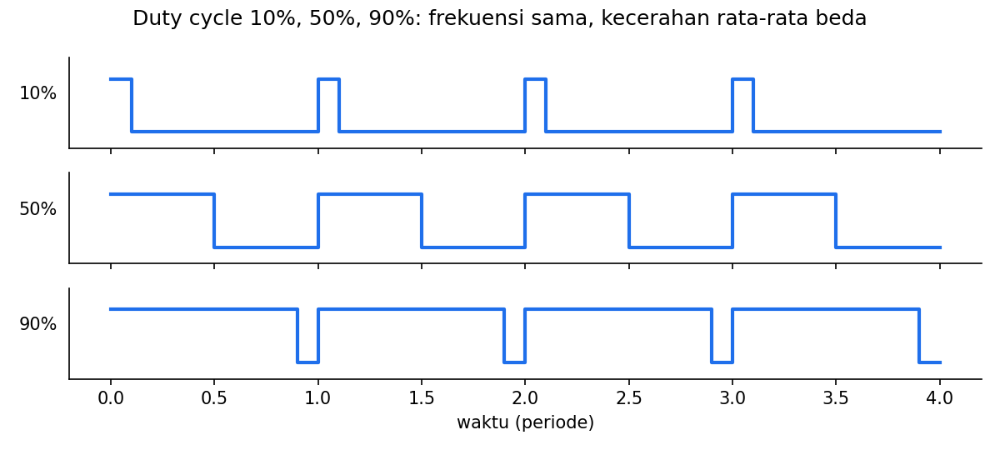
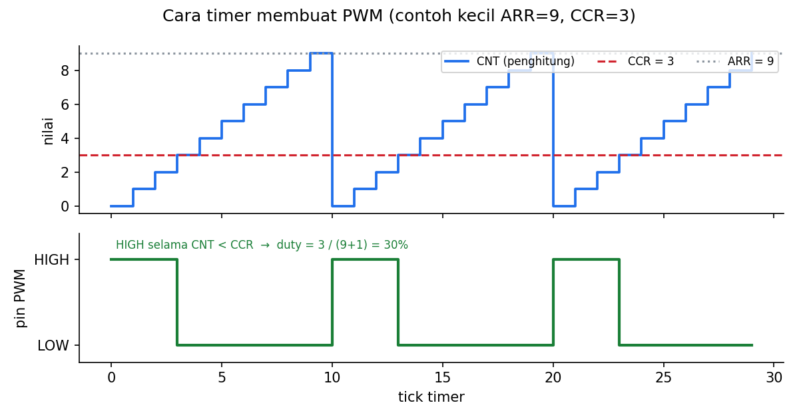

# Level 4: PWM untuk Kecerahan LED

[← Level 3](03-event-tombol.md) · [Beranda](../README.md) · [Level 5: Heartbeat →](05-heartbeat.md)

> [!NOTE]
> Tujuan level ini: mengontrol kecerahan LED dari 0 sampai 100% lewat satu fungsi, `led_set_brightness(percent)`. Fungsi inilah yang nanti dipakai heartbeat dan state machine.

## Tujuan belajar

- [ ] Menjelaskan PWM, duty cycle, dan hubungannya dengan kecerahan
- [ ] Memahami peran PSC, ARR, dan CCR pada timer
- [ ] Menghitung frekuensi PWM dan duty cycle dari angka-angkanya
- [ ] Mengonfigurasi TIM1 CH1 pada PA8 dan menggerakkannya dari kode

**Prasyarat:** [Level 2](02-waktu.md). Pindahkan LED eksternal dari PA5 ke **PA8** (lewat resistor 330 Ω ke GND). PA5 tidak punya keluaran timer.

---

## 🧠 Konsep

### 1. Mengapa bukan sekadar ON/OFF

Pin digital hanya HIGH atau LOW. Untuk membuat kecerahan di antaranya, kita menyalakan dan mematikan pin **sangat cepat**. Mata manusia hanya menangkap rata-ratanya. Rasio waktu ON terhadap satu siklus disebut **duty cycle**:

$$ D = \frac{t_{ON}}{T_{PWM}} \times 100\% $$



Tegangan rata-rata di pin kira-kira $V_{avg} = D \times 3{,}3\ \text{V}$. Frekuensi PWM harus cukup tinggi supaya kedipan tidak terlihat: **di atas ±100 Hz** (kita memakai 1 kHz).

### 2. Timer: penghitung yang bekerja otomatis

Membuat PWM dengan `HAL_GPIO_TogglePin` + delay akan menghabiskan seluruh CPU. Sebagai gantinya, **timer** (periferal hardware) melakukannya sendiri tanpa beban CPU setelah dikonfigurasi. Timer pada dasarnya adalah **penghitung** yang naik satu per tick, lalu kembali ke 0.

Tiga angka mengatur perilakunya:

| Register | Nama | Fungsi |
|---|---|---|
| **PSC** | Prescaler | membagi clock sistem menjadi clock timer yang lebih lambat |
| **ARR** | Auto-Reload Register | nilai tertinggi yang dicapai penghitung sebelum kembali ke 0 (menentukan **periode**) |
| **CCR** | Capture/Compare Register | nilai pembanding (menentukan **duty cycle**) |



Pada *PWM mode 1* (yang dipakai CubeMX), pin **HIGH selama penghitung < CCR**, lalu LOW sampai penghitung kembali ke 0.

### 3. Hitungan (konsep dulu, baru angka)

Urutan perhitungan selalu: clock sistem → dibagi PSC → dibagi periode (ARR) → frekuensi PWM.

$$ f_{TIM} = \frac{f_{HCLK}}{PSC + 1} \qquad f_{PWM} = \frac{f_{TIM}}{ARR + 1} \qquad D = \frac{CCR}{ARR + 1} $$

Angka dari Modul 4 (PSC = 71, ARR = 999, HCLK = 72 MHz):

$$ f_{TIM} = \frac{72\,000\,000}{71+1} = 1\,000\,000\ \text{Hz} \qquad f_{PWM} = \frac{1\,000\,000}{999+1} = 1000\ \text{Hz} $$

| CCR | Duty | Kecerahan |
|---:|---:|---|
| 0 | 0% | mati total |
| 250 | 25% | redup |
| 500 | 50% | sedang |
| 999 | 99,9% | hampir penuh |
| **1000** | **100%** | penuh (CCR > ARR → pin tidak pernah LOW) |

> [!IMPORTANT]
> Penyebut duty adalah **ARR + 1**, bukan ARR. Maka untuk 100% kamu butuh **CCR = ARR + 1 = 1000**. Ini sering salah dan membuat LED tidak pernah benar-benar penuh.

**Mengganti frekuensi:** jika kamu ingin 2 kHz dengan $f_{TIM}$ tetap 1 MHz: $ARR + 1 = 1\,000\,000 / 2000 = 500$, jadi **ARR = 499**. Untuk 100 Hz: $ARR + 1 = 10\,000$, jadi ARR = 9999.

**Trade-off:** ARR + 1 juga jumlah **tingkat kecerahan** yang tersedia (resolusi). ARR = 999 berarti 1000 tingkat; ARR = 499 berarti 500 tingkat. Frekuensi lebih tinggi = resolusi lebih kasar, kalau $f_{TIM}$ tetap.

### 4. Konfigurasi di CubeMX

1. Klik pin **PA8** → `TIM1_CH1`.
2. Timers → **TIM1**: *Clock Source* = **Internal Clock**, *Channel1* = **PWM Generation CH1**.
3. *Parameter Settings*: **Prescaler = 71**, *Counter Period (ARR)* = **999**, *Pulse (CCR)* = 0.
4. Generate Code.

### 5. Perintah HAL untuk PWM

| Tujuan | Kode |
|---|---|
| Mulai PWM (sekali, di `USER CODE 2`) | `HAL_TIM_PWM_Start(&htim1, TIM_CHANNEL_1);` |
| Ubah duty (kapan saja) | `__HAL_TIM_SET_COMPARE(&htim1, TIM_CHANNEL_1, ccr);` |
| Baca nilai ARR | `__HAL_TIM_GET_AUTORELOAD(&htim1)` |

> [!NOTE]
> Tanpa `HAL_TIM_PWM_Start`, timer tidak mengeluarkan apa pun di pin. Ini kesalahan nomor satu pada PWM.

### 6. Catatan tentang persepsi

Mata manusia tidak merespons kecerahan secara linear: duty 10% sudah terlihat cukup terang, dan perubahan 90% ke 100% hampir tak terlihat. Ini akan terasa di Level 5 dan 6; **koreksi gamma** (opsional) ada sebagai tantangan lanjutan.

---

## 🧪 Latihan

### 4A. Duty statis

**Aturan:** setelah memulai PWM, set CCR statis ke 0, 100, 500, 1000, satu per satu (ubah kode, flash ulang), dan amati.

| CCR | Duty yang kamu hitung | Kecerahan yang kamu lihat |
|---:|---|---|
| 0 | | |
| 100 | | |
| 500 | | |
| 1000 | | |

**Hasil yang diharapkan:** kecerahan naik dengan CCR; 0 benar-benar mati; 1000 benar-benar penuh.

### 4B. Hitung di kertas, lalu buktikan

Jawab dulu di kertas, baru uji di board dengan mengubah setting CubeMX:

1. Jika PSC = 71 dan kamu ingin PWM **2 kHz**, berapa ARR?
2. Dengan ARR itu, berapa CCR untuk duty **25%**?
3. Untuk PWM **500 Hz** dengan PSC = 71, berapa ARR?

<details>
<summary>▶ Kunci jawaban</summary>

1. $f_{PWM} = f_{TIM}/(ARR+1)$ → $ARR + 1 = 1\,000\,000 / 2000 = 500$ → **ARR = 499**.
2. $CCR = 0{,}25 \times 500 = 125$.
3. $ARR + 1 = 1\,000\,000 / 500 = 2000$ → **ARR = 1999**.

</details>

> [!TIP]
> Kesalahan paling umum pada soal-soal ini adalah lupa "+1" pada ARR.

### 4C. Pembuktian dengan multimeter (opsional)

Lepas LED. Ukur tegangan DC antara PA8 dan GND dengan multimeter, saat CCR = 250, 500, 750. Bandingkan dengan $D \times 3{,}3$ V.

**Hasil yang diharapkan:** ≈ 0,83 V, 1,65 V, 2,48 V. Multimeter DC merata-ratakan sinyal seperti mata merata-ratakan kedipan.

### 4D. Fungsi `led_set_brightness()`

**Aturan:** buat fungsi dengan prototipe

```c
void led_set_brightness(uint8_t percent);   // 0..100
```

yang:

1. membatasi `percent` ke 100 jika lebih besar,
2. menghitung CCR dari ARR yang dibaca dari timer (jangan hard-code 1000),
3. menuliskannya dengan `__HAL_TIM_SET_COMPARE`.

Uji dengan memanggilnya bergantian (0, 25, 50, 75, 100), masing-masing 1 detik, **tanpa `HAL_Delay`** (pakai pola Level 2).

**Hasil yang diharapkan:** LED melangkah dalam lima tingkat kecerahan jelas, dan 0/100 benar-benar mati/penuh.

<details>
<summary>▶ Petunjuk 1: rumusnya</summary>

Dari $D = CCR/(ARR+1)$ maka $CCR = D \times (ARR+1)$. Dengan `percent` sebagai persen: $CCR = percent \times (ARR+1) / 100$.

</details>

<details>
<summary>▶ Petunjuk 2: hati-hati urutan operasi integer</summary>

Pada integer, `percent * (arr + 1) / 100` aman karena perkalian dulu baru pembagian. Jika ditulis `percent / 100 * (arr + 1)` hasilnya selalu 0 untuk persen < 100 (pembagian integer memotong pecahan).

</details>

---

## ✅ Checkpoint: lulus jika

- [ ] `led_set_brightness(0)` mati total, `led_set_brightness(100)` menyala penuh
- [ ] Kamu bisa menghitung frekuensi PWM dan CCR dari PSC/ARR tanpa melihat catatan
- [ ] Kamu paham kenapa 100% butuh CCR = ARR + 1

## ❓ Cek pemahaman

**1.** PSC = 35, ARR = 1999, HCLK = 72 MHz. Berapa $f_{PWM}$?

**2.** Dengan ARR = 999, berapa CCR untuk duty 80%?

**3.** Kenapa PWM butuh frekuensi minimal sekitar 100 Hz untuk LED?

**4.** LED tidak menyala sama sekali padahal CCR = 500. Sebutkan dua penyebab yang mungkin.

<details>
<summary>▶ Kunci jawaban (tulis jawabanmu dulu)</summary>

1. $f_{TIM} = 72\,000\,000/36 = 2\,000\,000$ Hz, lalu $f_{PWM} = 2\,000\,000/2000 = 1000$ Hz.
2. $CCR = 0{,}8 \times 1000 = 800$.
3. Di bawah itu mata mulai melihat kedipan, bukan kecerahan rata-rata.
4. Contoh: lupa `HAL_TIM_PWM_Start`; LED masih terpasang di PA5 (bukan PA8); LED terbalik arah; clock timer/kanal belum dikonfigurasi.

</details>

## ⚠️ Kesalahan umum

| Gejala | Penyebab |
|---|---|
| LED selalu mati | belum `HAL_TIM_PWM_Start`, atau PA8 belum `TIM1_CH1` |
| LED tidak pernah benar-benar penuh | CCR maksimum diset ARR, bukan ARR + 1 |
| LED berkedip terlihat | ARR terlalu besar → frekuensi PWM terlalu rendah |
| `led_set_brightness(50)` selalu 0 | urutan pembagian integer salah |

---

[← Level 3](03-event-tombol.md) · [Beranda](../README.md) · [Level 5: Heartbeat →](05-heartbeat.md)
