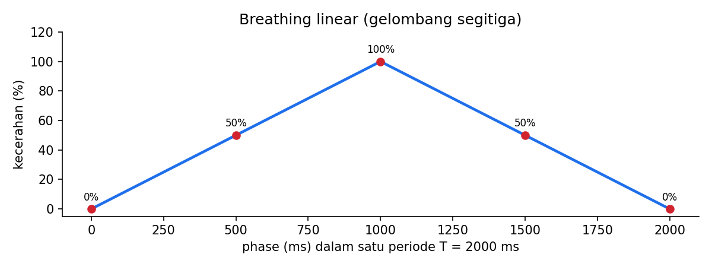

# Level 5: Heartbeat Linear dengan Periode T

[← Level 4](04-pwm.md) · [Beranda](../README.md) · [Level 6: Gaussian →](06-gaussian.md)

> [!NOTE]
> Tujuan level ini: membuat LED "bernapas" (naik 0→100%, turun 100→0%) dengan periode $T$ yang bisa diubah, **tanpa memblokir CPU**. Ini inti dari mode HB di P4.

## Tujuan belajar

- [ ] Memahami kenapa loop `for` + `HAL_Delay` tidak cocok untuk P4
- [ ] Menghitung *fase* dari waktu dengan operator modulo
- [ ] Mengubah fase menjadi kecerahan segitiga memakai integer
- [ ] Menulis modul heartbeat dengan API `start/stop/update`

**Prasyarat:** [Level 2](02-waktu.md), [Level 4](04-pwm.md) (`led_set_brightness`).

---

## 🧠 Konsep

### 1. Masalah pada contoh di Modul 4

Contoh Modul 4 memakai dua loop `for` dengan `HAL_Delay(1)`:

- periodenya **terkunci** (≈ 2 detik), padahal P4 membutuhkan periode $T$ yang berubah-ubah,
- CPU **terblokir** selama napas berlangsung, padahal board juga harus membaca tombol dan UART.

Solusinya adalah mengubah cara berpikir:

> **Kecerahan adalah fungsi dari waktu**, bukan hasil dari sebuah loop yang berjalan.

Setiap putaran `while(1)`, kita hanya bertanya: "sekarang jam berapa, jadi seharusnya seterang apa?" Tidak ada yang perlu ditunggu.

### 2. Fase: posisi di dalam satu periode

Simpan waktu mulai `t0` saat heartbeat dimulai. **Fase** adalah berapa lama yang telah berlalu di dalam siklus saat ini:

$$ \text{phase} = (\text{now} - t_0) \bmod T \qquad\Rightarrow\qquad 0 \le \text{phase} < T $$

Operator `%` di C membuat fase otomatis kembali ke 0 setiap satu periode, sehingga napas berulang selamanya.

**Contoh:** $T = 2000$ ms, `t0 = 5000`, `now = 12 300`.

$$ \text{now} - t_0 = 7300 \quad\Rightarrow\quad 7300 \bmod 2000 = 1300 $$

Jadi saat itu LED berada di 1300 ms dari siklus 2000 ms, yaitu pada paruh turun.

### 3. Dari fase ke kecerahan: gelombang segitiga

Paruh pertama periode: naik. Paruh kedua: turun.

$$
B(\text{phase}) =
\begin{cases}
\dfrac{\text{phase}}{T/2} & \text{jika } \text{phase} < T/2 \\[3mm]
\dfrac{T - \text{phase}}{T/2} & \text{jika } \text{phase} \ge T/2
\end{cases}
$$

$B$ bernilai 0 sampai 1 (0% sampai 100%).



| phase (ms) pada $T = 2000$ | Hitungan | $B$ |
|---:|---|---:|
| 0 | 0 / 1000 | 0% |
| 500 | 500 / 1000 | 50% |
| 1000 | batas paruh | 100% |
| 1500 | (2000 − 1500) / 1000 | 50% |
| 1999 | (2000 − 1999) / 1000 | ≈ 0,1% |

### 4. Menghitung pakai integer

CPU F103 tidak punya FPU, jadi hindari `float`. Skalakan langsung ke CCR. Dengan penuh = ARR + 1 = 1000:

$$ \text{ccr} = \frac{\text{phase} \times 2000}{T} \quad (\text{paruh naik}) \qquad \text{ccr} = \frac{(T - \text{phase}) \times 2000}{T} \quad (\text{paruh turun}) $$

**Cek:** pada phase = $T/2$: $(T/2) \times 2000 / T = 1000$ ✅ (100%).

Mengapa angkanya 2000? Karena $\dfrac{\text{phase}}{T/2} \times 1000 = \dfrac{\text{phase} \times 2000}{T}$.

> [!WARNING]
> **Urutan operasi integer.** Kalikan **dulu**, bagi **kemudian**. Jika dibagi dulu (`phase / T * 2000`), hasilnya 0 hampir selalu karena pembagian integer memotong pecahan.
>
> **Overflow:** `phase * 2000` pada `uint32_t` aman selama $\text{phase} \times 2000 < 4{,}29 \times 10^9$, yaitu sampai $T$ sekitar 35 menit. Untuk tugas ini sangat aman.

### 5. Hal-hal kecil yang menentukan

| Situasi | Cara menanganinya |
|---|---|
| T berubah di tengah jalan | set `t0 = now` (mulai siklus baru dari 0%), supaya tidak ada lompatan kecerahan |
| Awal heartbeat | `t0 = now` membuat kecerahan mulai dari 0% |
| Keluar dari heartbeat | **eksplisit** set kecerahan ke 0 (jangan biarkan di nilai terakhir) |
| $T$ minimal | PRESS didefinisikan $T > 1000$ ms, sehingga $T/2 \ge 500$ ms: aman dari pembagian 0 |
| Resolusi | selama napas, CCR berubah antara 0–1000; dengan $T = 1000$ ms ada paling banyak 1000 langkah per siklus |

---

## 🧩 Rancangan modul

```c
void heartbeat_start(uint32_t period_ms);    // mulai (atau mulai ulang) dengan periode T
void heartbeat_stop(void);                   // berhenti; kecerahan kembali 0
void heartbeat_update(uint32_t now_ms);      // dipanggil tiap putaran loop
```

Kerangka berkas: [`exercises/level-05-heartbeat/`](../exercises/level-05-heartbeat/).

---

## 🧪 Latihan

### 5A. Hitung dulu di kertas

Untuk $T = 1500$ ms, lengkapi tabel (nilai CCR dengan penuh = 1000):

| phase (ms) | paruh | CCR |
|---:|---|---:|
| 0 | | |
| 375 | | |
| 750 | | |
| 1125 | | |
| 1499 | | |

<details>
<summary>▶ Kunci jawaban</summary>

$T/2 = 750$. Rumus naik: $\text{phase} \times 2000 / 1500$. Rumus turun: $(1500 - \text{phase}) \times 2000 / 1500$.

| phase | paruh | CCR |
|---:|---|---:|
| 0 | naik | 0 |
| 375 | naik | 500 |
| 750 | turun (batas) | 1000 |
| 1125 | turun | 500 |
| 1499 | turun | 1 ($2000/1500 \approx 1{,}33$, dibulatkan ke bawah) |

</details>

### 5B. Heartbeat tetap, T = 2000 ms

**Aturan:** tulis `heartbeat_update(now)` yang menghitung fase, kecerahan, lalu memanggil `led_set_brightness`-nya. Mulai dengan `T` dan `t0` sebagai variabel `static` di modul. Panggil dari `while(1)` tiap putaran. Jangan pakai `HAL_Delay`.

> [!TIP]
> `led_set_brightness` dari Level 4 bekerja dalam persen. Untuk heartbeat kamu butuh presisi lebih halus (1000 langkah). Tambahkan fungsi baru yang menerima CCR langsung (misalnya `led_set_raw(uint16_t ccr)`), atau skalakan ke persen dengan resolusi lebih halus.

**Hasil yang diharapkan:** LED naik dan turun halus, satu napas ≈ 2 detik (cek dengan stopwatch: 10 napas ≈ 20 detik).

<details>
<summary>▶ Petunjuk 1: kerangka</summary>

```c
void heartbeat_update(uint32_t now)
{
    if (!active) return;

    uint32_t phase = (now - t0) % period;
    uint32_t half  = period / 2;
    uint32_t ccr;

    if (phase < half) { /* rumus naik */ }
    else              { /* rumus turun */ }

    /* tulis ke timer */
}
```

</details>

<details>
<summary>▶ Petunjuk 2: LED tampak "tersentak" di akhir</summary>

Periksa urutan operasi integer dan pastikan paruh turun memakai $(T - \text{phase})$, bukan $(\text{phase} - T)$ (yang meluap di `uint32_t`).

</details>

### 5C. Periode dari tekanan tombol

**Aturan:** gabungkan modul tombol (Level 3) dan heartbeat. Perilaku:

- KLIK → `heartbeat_stop()` dan LED mati,
- PRESS dengan durasi $T$ → `heartbeat_start(T)`.

Tekan lama selama 1,5 s, lepas → LED bernapas dengan periode 1,5 s. Lalu tekan lama 3 s → periode berubah jadi 3 s.

**Hasil yang diharapkan:** periode napas yang kamu ukur dengan stopwatch cocok dengan durasi tekan, dan tombol tetap responsif saat LED sedang bernapas.

### 5D. Uji ketahanan

Saat LED bernapas, uji tiga hal:

| Uji | Seharusnya |
|---|---|
| KLIK saat bernapas | berhenti dan mati |
| PRESS saat bernapas dengan T berbeda | periode langsung berganti, tanpa lompatan kecerahan |
| Biarkan 5 menit | tidak ada drift atau hang |

---

## ✅ Checkpoint: lulus jika

- [ ] Periode napas cocok dengan $T$ dari tekanan tombol (±5%)
- [ ] Tombol tetap responsif saat LED bernapas (tidak ada `HAL_Delay` di jalur ini)
- [ ] Kamu bisa menjelaskan fase dan kenapa memakai modulo

## ❓ Cek pemahaman

**1.** $T = 3000$, `t0 = 100`, `now = 4700`. Berapa fase? Di paruh mana?

**2.** Untuk fase pada soal 1, berapa CCR (penuh = 1000)?

**3.** Kenapa `phase / T * 2000` selalu menghasilkan 0 (untuk phase < T)?

**4.** Kenapa $T$ di P4 pasti tidak nol dan tidak terlalu kecil?

<details>
<summary>▶ Kunci jawaban (tulis jawabanmu dulu)</summary>

1. $4700 - 100 = 4600$; $4600 \bmod 3000 = 1600$. $T/2 = 1500$, jadi sudah di **paruh turun**.
2. $(3000 - 1600) \times 2000 / 3000 = 1400 \times 2000 / 3000 = 933$ (dibulatkan ke bawah dari 933,3).
3. `phase / T` pada integer adalah 0 untuk phase < T, sehingga seluruh hasilnya 0.
4. PRESS didefinisikan sebagai $T > 1000$ ms, jadi $T \ge 1001$.

</details>

## ⚠️ Kesalahan umum

| Gejala | Penyebab |
|---|---|
| LED hanya menyala/mati, tidak halus | pembagian integer terlalu dini |
| Lompatan kecerahan saat ganti T | `t0` tidak di-reset saat periode berubah |
| Periode meleset | `now - t0` diganti perbandingan mutlak, atau `T` salah satuan (detik vs ms) |
| LED tetap redup setelah KLIK | `heartbeat_stop()` tidak menulis kecerahan 0 |

---

[← Level 4](04-pwm.md) · [Beranda](../README.md) · [Level 6: Gaussian →](06-gaussian.md)
