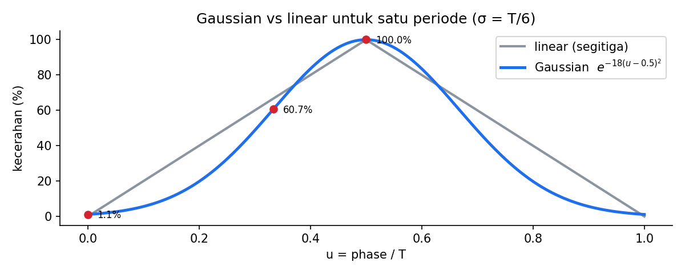

# Level 6 (Bonus): Heartbeat Distribusi Normal

[← Level 5](05-heartbeat.md) · [Beranda](../README.md) · [Level 7: UART →](07-uart.md)

> [!NOTE]
> Level ini **bonus** (sesuai dokumen P4: "Implementasi Bonus: Distribusi Normal"). Kamu boleh melewatinya dulu dan kembali setelah Level 12.

## Tujuan belajar

- [ ] Memahami bentuk kurva Gaussian dan parameter $\mu$, $\sigma$
- [ ] Menurunkan rumus kecerahan untuk satu periode $T$
- [ ] Memilih antara `expf()` dan *lookup table* (LUT) untuk MCU tanpa FPU
- [ ] Membuat LUT dengan skrip Python dan memakainya di firmware

**Prasyarat:** [Level 5](05-heartbeat.md).

---

## 🧠 Konsep

### 1. Kurva lonceng

Distribusi normal berbentuk lonceng: halus di kedua ujung, puncak di tengah. Bentuk umumnya:

$$ f(x) = \exp\!\left( -\frac{(x-\mu)^2}{2\sigma^2} \right) $$

| Parameter | Arti | Pilihan kita |
|---|---|---|
| $\mu$ | posisi puncak | $T/2$ (tengah periode) |
| $\sigma$ | lebar lonceng | $T/6$ |

Nilai $f$ di puncak = 1 (100% kecerahan), turun halus ke hampir 0 di ujung.

### 2. Kenapa $\sigma = T/6$?

Ujung periode ($x = 0$ dan $x = T$) berjarak $T/2$ dari puncak, yaitu **3σ** ketika $\sigma = T/6$. Pada 3σ nilai kurva sudah sangat kecil, jadi LED hampir mati di awal dan akhir napas, dan siklus berikutnya menyambung mulus.

| Posisi $x$ | Jarak dari $\mu$ | $f$ |
|---|---|---:|
| $T/2$ | 0 | $e^{0} = 1{,}000$ (100%) |
| $T/3$ | 1σ | $e^{-0{,}5} \approx 0{,}607$ (60,7%) |
| $T/6$ | 2σ | $e^{-2} \approx 0{,}135$ (13,5%) |
| $0$ | 3σ | $e^{-4{,}5} \approx 0{,}011$ (1,1%) |

### 3. Rumus ternormalisasi (tidak bergantung T)

Definisikan $u = \text{phase}/T$ sehingga $0 \le u < 1$. Dengan $\mu = 0{,}5$ dan $\sigma = 1/6$:

$$ B(u) = \exp\!\left( -\frac{(u - 0{,}5)^2}{2 \times (1/6)^2} \right) = \exp\!\bigl( -18\,(u - 0{,}5)^2 \bigr) $$

Cek: $u = 0 \Rightarrow \exp(-18 \times 0{,}25) = \exp(-4{,}5)$ ✅ cocok dengan tabel.

Karena rumusnya hanya bergantung pada $u$, **satu tabel cukup untuk semua $T$**.



### 4. Dua cara menghitung di firmware

| Cara | Cara kerja | Plus | Minus |
|---|---|---|---|
| **`expf()`** (`math.h`) | hitung langsung tiap putaran | rumus jelas, mudah dicek | tanpa FPU, dihitung lewat software (*soft-float*): lambat |
| **LUT** (lookup table) | hitung N nilai **sekali** (di laptop), simpan sebagai array `const`, lalu cukup membaca | sangat cepat | perlu skrip pembuat tabel |

**Merancang LUT dengan $N = 256$ entri:**

- Indeks dari fase: $\text{index} = \dfrac{\text{phase} \times 256}{T}$. Karena phase < T, hasilnya 0 sampai 255. Kalikan dulu baru bagi.
- Nilai entri: $\text{round}\bigl(B(u_i) \times 1000\bigr)$ dengan $u_i = i/256$ (atau $(i+0{,}5)/256$), sehingga langsung berupa CCR (penuh = 1000).
- Memori: $256 \times 2$ byte = 512 byte. Taruh sebagai `static const uint16_t`, sehingga berada di Flash, bukan RAM.

> [!TIP]
> Kurva simetris: $B(u) = B(1-u)$. Kamu bisa menyimpan hanya separuh tabel (128 entri) dan mencerminkan indeks. Ini tantangan opsional.

### 5. Catatan persepsi (opsional)

Mata merespons kecerahan secara tidak linear. Banyak implementasi menerapkan **koreksi gamma**: $\text{CCR}_{out} = \text{CCR}^{\gamma}$ (ternormalisasi), dengan $\gamma \approx 2{,}2$. Itu bisa dimasukkan ke dalam LUT yang sama, tanpa biaya tambahan saat berjalan.

---

## 🧪 Latihan

### 6A. Hitung manual

Dengan $B(u) = e^{-18(u - 0{,}5)^2}$, hitung (kalkulator) untuk $u = 0{,}25$ dan $u = 0{,}4$.

<details>
<summary>▶ Kunci jawaban</summary>

- $u = 0{,}25$: $(−0{,}25)^2 = 0{,}0625$ → $\exp(-1{,}125) \approx 0{,}325$ (32,5%).
- $u = 0{,}4$: $(−0{,}1)^2 = 0{,}01$ → $\exp(-0{,}18) \approx 0{,}835$ (83,5%).

</details>

### 6B. Versi `expf()`

**Aturan:** tambahkan mode Gaussian ke modul heartbeat memakai `expf()` dari `math.h`. Hitung $u$ sebagai `float` dari fase.

**Hasil yang diharapkan:** LED bernapas lebih lembut di awal dan akhir dibanding versi linear, dengan periode sama persis.

> [!NOTE]
> Kalau linker mengeluh soal `expf`, pastikan library matematika ikut ter-link. Pada project CubeIDE (newlib) biasanya sudah otomatis.

### 6C. Ukur biayanya

Ukur sendiri berapa lama satu perhitungan `expf()`:

```c
uint32_t t0 = HAL_GetTick();
volatile float sink;
for (int i = 0; i < 1000; i++) { sink = expf(-18.0f * ((i / 1000.0f) - 0.5f) * ((i / 1000.0f) - 0.5f)); }
uint32_t dt = HAL_GetTick() - t0;   // ms untuk 1000 perhitungan → dt µs per perhitungan
```

Baca `dt` di Live Expressions. Lalu pertimbangkan: berapa persen dari satu putaran loop yang kamu habiskan hanya untuk ini?

### 6D. Buat LUT dengan Python

**Aturan:** tulis skrip `tools/gen_lut.py` (kerangka di [`exercises/level-06-gaussian/`](../exercises/level-06-gaussian/)) yang mencetak array C berisi 256 nilai `uint16_t` dengan rumus di atas, siap tempel ke `.c`.

**Hasil yang diharapkan:** entri tengah (indeks 128) ≈ 1000 (puncak) dan entri 0 ≈ 11.

### 6E. Versi LUT dan saklar mode

**Aturan:**

1. Tempel LUT ke firmware sebagai `static const uint16_t gauss_lut[256]`.
2. Ganti perhitungan Gaussian dengan pembacaan tabel (`index = phase * 256 / T`).
3. Tambahkan satu `#define HB_MODE_GAUSSIAN 1` (atau 0 untuk linear) untuk berpindah mode.

**Hasil yang diharapkan:** tampilan sama seperti 6B, tetapi lebih ringan. Bandingkan hasilnya berdampingan (flash versi `expf()` lalu versi LUT).

---

## ✅ Checkpoint: lulus jika

- [ ] LED terlihat lebih lembut di awal dan akhir dibanding versi linear
- [ ] Periode tetap sama dengan $T$ (cek dengan stopwatch)
- [ ] Kamu bisa menjelaskan kenapa satu LUT cukup untuk semua $T$

## ❓ Cek pemahaman

**1.** Kenapa $\sigma = T/6$, bukan $T/2$?

**2.** Berapa indeks LUT untuk phase = 750 pada $T = 3000$ ($N = 256$)?

**3.** Kenapa LUT lebih cocok daripada `expf()` di F103?

<details>
<summary>▶ Kunci jawaban (tulis jawabanmu dulu)</summary>

1. Dengan $\sigma = T/2$, ujung periode hanya berjarak 1σ dari puncak, sehingga kecerahan di awal dan akhir masih sekitar 60%, bukan mendekati 0. LED akan "melompat" saat siklus berganti.
2. $750 \times 256 / 3000 = 64$. (Itu seperempat periode, yaitu $u = 0{,}25$.)
3. F103 tidak punya FPU sehingga operasi `float` berjalan lewat software dan lambat; LUT hanya membaca satu elemen array.

</details>

---

[← Level 5](05-heartbeat.md) · [Beranda](../README.md) · [Level 7: UART →](07-uart.md)
