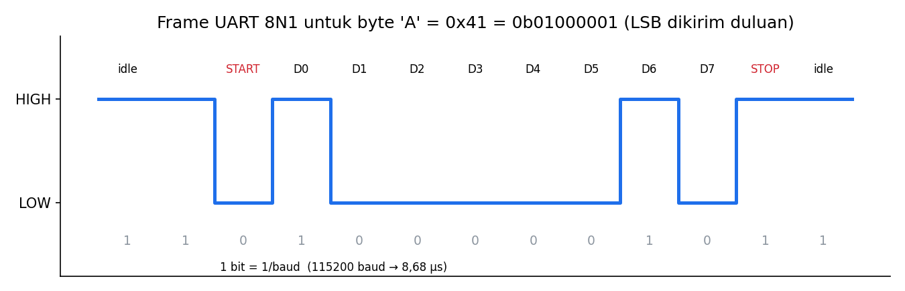

# Level 7: UART Dasar

[← Level 6](06-gaussian.md) · [Beranda](../README.md) · [Level 8: UART Interrupt →](08-uart-interrupt.md)

> [!NOTE]
> Tujuan level ini: memahami bagaimana dua perangkat saling mengirim byte lewat dua kabel, lalu membuktikannya di board dan di terminal laptop.

## Tujuan belajar

- [ ] Menjelaskan serial vs paralel, asinkron vs sinkron, simplex/half/full duplex
- [ ] Membaca frame UART 8N1 dan menghitung waktunya dari baud rate
- [ ] Mengonfigurasi USART1 di CubeMX dan mengirim/menerima dengan `HAL_UART_Transmit/Receive`
- [ ] Memakai terminal serial di laptop dan mengenali gejala *baud mismatch*

**Prasyarat:** [Level 2](02-waktu.md). Disarankan punya USB-TTL 3,3 V (opsional, tetapi sangat membantu).

---

## 🧠 Konsep

### 1. Peta istilah dari slide pelatihan

| Pasangan | Arti | UART |
|---|---|---|
| **Serial** vs paralel | serial: satu bit per waktu lewat satu jalur; paralel: banyak bit sekaligus lewat banyak jalur | serial |
| **Asinkron** vs sinkron | asinkron: **tanpa** jalur clock bersama; sinkron: ada jalur clock | asinkron |
| **Simplex / half-duplex / full-duplex** | satu arah / dua arah bergantian / dua arah bersamaan | **full-duplex** |

Karena UART asinkron, kedua sisi harus **sepakat soal kecepatan** (baud rate) sebelum bicara. Karena full-duplex, UART punya **dua jalur terpisah**: **TX** (kirim) dan **RX** (terima).

### 2. Frame UART 8N1

Saat tidak ada pengiriman, jalur ditahan **HIGH** (*idle*). Satu byte dikirim sebagai frame 10 bit:



| Bagian | Bit | Fungsi |
|---|---:|---|
| Start | 1 (LOW) | memberi tahu penerima: "mulai", sekaligus menyelaraskan jam penerima |
| Data | 8, **LSB duluan** | isi byte |
| Parity | 0 (N = none) | tidak dipakai |
| Stop | 1 (HIGH) | mengembalikan jalur ke idle |

"8N1" = 8 bit data, No parity, 1 stop bit.

**Contoh:** byte `'A'` = 0x41 = `0100 0001`. LSB duluan, bit data yang dikirim: `1 0 0 0 0 0 1 0`.

### 3. Hitungan waktu dari baud rate

Baud rate = jumlah bit per detik (untuk UART biner, baud = bit/s). Urutannya: **waktu satu bit** → **waktu satu byte** → **throughput**.

$$ t_{bit} = \frac{1}{\text{baud}} \qquad t_{byte} = 10 \times t_{bit} \qquad \text{throughput} = \frac{1}{t_{byte}}\ \text{byte/s} $$

| Baud | $t_{bit}$ | $t_{byte}$ | Throughput |
|---:|---:|---:|---:|
| 9600 | 104,2 µs | 1,042 ms | 960 byte/s |
| **115200** | **8,68 µs** | **86,8 µs** | **11 520 byte/s** |
| 921600 | 1,085 µs | 10,85 µs | 92 160 byte/s |

(Cocok dengan tabel di slide *Mismatched Baud Rate*.)

Kenapa throughput bukan baud / 8? Karena 2 dari 10 bit adalah *overhead* (start + stop). Hanya 80% yang berisi data.

**Contoh pakai:** pesan 5 byte pada 115200 baud memakan $5 \times 86{,}8 = 434\ \mu s$. Itu sangat singkat, sehingga mengirimnya dengan fungsi blocking di loop utama tidak masalah.

### 4. Bagaimana STM32 membuat baud rate

Periferal USART membagi clock bus-nya. USART1 berada di bus APB2 (72 MHz):

$$ \text{USARTDIV} = \frac{f_{PCLK2}}{\text{baud}} = \frac{72\,000\,000}{115\,200} = 625 $$

Hasilnya bulat (625), jadi kesalahan baud-nya **0%**. CubeMX menghitung ini otomatis; tujuan hitungan ini hanya supaya kamu tahu bahwa clock yang salah → baud yang meleset.

**Toleransi:** penerima mengambil sampel di tengah tiap bit. Setelah 10 bit, selisih kecepatan yang terakumulasi tidak boleh melebihi setengah bit. Secara praktis, selisih baud sampai ±2 sampai 3% masih aman. Selisih besar, misalnya 9600 vs 115200, menghasilkan karakter sampah.

### 5. Hal-hal listrik yang wajib diingat

> [!IMPORTANT]
> 1. **Menyilang:** TX milik A ke **RX** milik B, dan RX milik A ke **TX** milik B.
> 2. **GND bersama.** Tanpa referensi tegangan yang sama, level HIGH/LOW tidak punya arti.
> 3. **Level 3,3 V.** Pakai USB-TTL 3,3 V. Jangan menyambungkan RS-232 (±12 V) langsung ke pin STM32.

### 6. Konfigurasi di CubeMX

1. Connectivity → **USART1** → *Mode* = **Asynchronous**.
2. Pin otomatis: **PA9 = USART1_TX**, **PA10 = USART1_RX**.
3. Parameter: *Baud Rate* = **115200**, *Word Length* = 8 Bits, *Parity* = None, *Stop Bits* = 1.
4. Generate Code.

### 7. Fungsi HAL dasar

```c
HAL_StatusTypeDef HAL_UART_Transmit(&huart1, uint8_t *data, uint16_t len, uint32_t timeout_ms);
HAL_StatusTypeDef HAL_UART_Receive (&huart1, uint8_t *buf,  uint16_t len, uint32_t timeout_ms);
```

Keduanya **blocking**: fungsi baru kembali setelah selesai atau timeout. Hasilnya `HAL_OK`, `HAL_TIMEOUT`, `HAL_ERROR`, atau `HAL_BUSY`.

Mengirim angka/teks dengan format:

```c
#include <stdio.h>
#include <string.h>

char msg[64];
int n = snprintf(msg, sizeof(msg), "count=%lu\r\n", (unsigned long)counter);
HAL_UART_Transmit(&huart1, (uint8_t*)msg, n, 100);
```

> [!NOTE]
> `\r\n` (carriage return + newline) membuat baris baru tampil rapi di sebagian besar terminal.

### 8. Terminal serial di laptop

| Sistem | Perintah / alat |
|---|---|
| Linux (Python) | `python3 -m serial.tools.miniterm /dev/ttyUSB0 115200` (butuh `pip install pyserial`) |
| Linux (picocom) | `picocom -b 115200 /dev/ttyUSB0` (keluar: `Ctrl+A` lalu `Ctrl+X`) |
| Windows | PuTTY atau Tera Term (Serial, COMx, 115200) |

Di Linux, jika muncul *permission denied*, tambahkan akunmu ke grup `dialout`, lalu login ulang:

```bash
sudo usermod -aG dialout $USER
```

---

## 🧪 Latihan

### 7A. Loopback satu board

**Aturan:** sambungkan **PA9 (TX) langsung ke PA10 (RX)** dengan satu kabel jumper. Kirim satu byte, lalu terima kembali. Jika byte yang diterima sama dengan yang dikirim, nyalakan PC13 (active-low).

```c
uint8_t tx = 'A', rx = 0;
HAL_UART_Transmit(&huart1, &tx, 1, 100);
HAL_StatusTypeDef st = HAL_UART_Receive(&huart1, &rx, 1, 100);
if (st == HAL_OK && rx == tx) { /* LED nyala */ }
```

**Hasil yang diharapkan:** LED menyala. Cabut jumper: LED tidak menyala (karena timeout).

<details>
<summary>▶ Petunjuk: urutan loopback</summary>

Karena TX tersambung ke RX, byte yang kamu kirim langsung masuk ke RX dan menunggu di register penerima. Karena itu `Receive` setelah `Transmit` bisa membacanya. Dalam kondisi nyata (dua board), byte datang kapan saja: itu yang akan kita tangani di Level 8.

</details>

### 7B. Hello ke laptop

**Aturan:** sambungkan USB-TTL: TX board → RX adaptor, RX board → TX adaptor, GND → GND. Setiap 1 detik (non-blocking, pola Level 2) kirim `"hello <counter>\r\n"`.

**Hasil yang diharapkan:** terminal menampilkan `hello 0`, `hello 1`, ... tiap detik.

### 7C. Echo

**Aturan:** terima satu byte (timeout pendek, misalnya 10 ms), kirim kembali apa pun yang diterima.

**Hasil yang diharapkan:** apa yang kamu ketik di terminal muncul kembali (echo).

> [!NOTE]
> Echo pada terminal bisa tampak "dobel" jika terminalmu juga melakukan *local echo*. Matikan opsi itu di terminal.

### 7D. Eksperimen baud mismatch

1. Ubah baud rate board menjadi **9600** di CubeMX, Generate, flash.
2. Biarkan terminal di 115200. Catat apa yang tampil.
3. Samakan lagi dan pastikan normal.

Jelaskan dengan kata-katamu: **kenapa** muncul karakter sampah? (Petunjuk: bandingkan $t_{bit}$ pengirim dan penerima.)

<details>
<summary>▶ Penjelasan</summary>

Pengirim memakai bit selebar 104 µs (9600 baud), sedangkan penerima mengambil sampel tiap 8,68 µs (115200 baud). Satu bit pengirim terbaca sebagai sekitar 12 bit oleh penerima, sehingga data yang ditafsirkan tidak mirip yang dikirim. Pesan yang sama terlihat "rusak" walaupun kabelnya benar.

</details>

### 7E. Bandingkan teori dan ukuran

**Aturan:** kirim **1000 byte** (misalnya 10 kali buffer 100 byte) dengan `HAL_UART_Transmit`, ukur waktunya pakai `HAL_GetTick()`, bandingkan dengan teori.

Teori pada 115200 baud: $1000 \times 86{,}8\ \mu s \approx 86{,}8$ ms.

**Hasil yang diharapkan:** ukuran ≈ 87–90 ms. Selisih kecil adalah overhead fungsi.

---

## ✅ Checkpoint: lulus jika

- [ ] Loopback 7A bekerja
- [ ] Terminal laptop menampilkan teks dari board dan echo berjalan
- [ ] Kamu bisa menjelaskan kenapa 7D menghasilkan sampah
- [ ] Hitungan teori 7E cocok dengan ukuran

## ❓ Cek pemahaman

**1.** Gambar frame untuk byte `0x55` (`0101 0101`). Bit apa saja yang dikirim, berurutan, termasuk start dan stop?

**2.** Berapa lama mengirim 20 byte pada 9600 baud?

**3.** Kenapa TX harus disambung ke RX, bukan TX ke TX?

**4.** Apa yang terjadi jika GND kedua perangkat tidak disambung?

<details>
<summary>▶ Kunci jawaban (tulis jawabanmu dulu)</summary>

1. LSB duluan: `0x55` = `01010101`, kebalikan urutannya (LSB→MSB) adalah `1 0 1 0 1 0 1 0`. Frame: start `0`, lalu `1 0 1 0 1 0 1 0`, lalu stop `1`. Total: `0 1 0 1 0 1 0 1 0 1`.
2. $20 \times 1{,}042 = 20{,}8$ ms.
3. Yang dikirim satu pihak harus **diterima** pihak lain; dua pin TX yang disambung saling "mendorong" tanpa ada yang mendengar (dan bisa berebut tegangan).
4. Tidak ada referensi tegangan bersama, sehingga level HIGH/LOW tidak terbaca dengan benar: data rusak atau tidak diterima sama sekali.

</details>

## ⚠️ Kesalahan umum

| Gejala | Penyebab |
|---|---|
| Karakter sampah | baud tidak sama, atau clock salah |
| Tidak ada data sama sekali | TX/RX tidak menyilang, GND tidak tersambung, atau port salah |
| `permission denied` di Linux | akun belum masuk grup `dialout` |
| Data terpotong | timeout `HAL_UART_Receive` terlalu pendek |

---

[← Level 6](06-gaussian.md) · [Beranda](../README.md) · [Level 8: UART Interrupt →](08-uart-interrupt.md)
