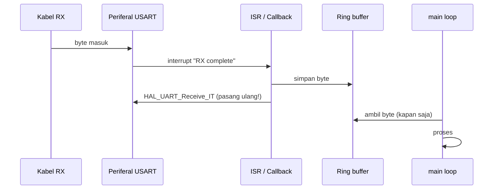

# Level 8: Menerima UART dengan Interrupt

[← Level 7](07-uart.md) · [Beranda](../README.md) · [Level 9: Dua Board →](09-dua-board.md)

> [!NOTE]
> Tujuan level ini: menerima data UART **kapan pun ia datang**, tanpa memblokir loop utama dan tanpa kehilangan byte. Ini adalah cara penerima di P4 bekerja.

## Tujuan belajar

- [ ] Menjelaskan kenapa `HAL_UART_Receive` (blocking) tidak cocok untuk P4
- [ ] Memakai pola "terima 1 byte per interrupt, lalu pasang ulang"
- [ ] Menulis ring buffer sederhana dan mengujinya di laptop
- [ ] Menangani error UART supaya penerimaan tidak "mati"

**Prasyarat:** [Level 3](03-event-tombol.md) (interrupt dan `volatile`), [Level 7](07-uart.md).

---

## 🧠 Konsep

### 1. Masalah `HAL_UART_Receive` blocking

Di Level 7, `HAL_UART_Receive(&huart1, buf, len, timeout)` menunggu sampai `len` byte datang atau timeout. Dua masalah untuk P4:

| Masalah | Akibat |
|---|---|
| **Menunggu** | loop terhenti, tombol dan LED tidak terlayani |
| **Panjang tetap** | penerima tidak tahu kapan pesan akan datang |

### 2. Pola: 1 byte per interrupt, lalu pasang ulang

Hardware UART memberi tahu CPU setiap kali **satu byte** selesai diterima. Kita menangkapnya satu per satu:



```c
uint8_t rx_byte;                                   // satu byte penampung

/* USER CODE BEGIN 2 */
HAL_UART_Receive_IT(&huart1, &rx_byte, 1);         // mulai: minta 1 byte
/* USER CODE END 2 */

void HAL_UART_RxCpltCallback(UART_HandleTypeDef *huart)
{
    if (huart == &huart1)
    {
        // simpan rx_byte (ke ring buffer)
        HAL_UART_Receive_IT(&huart1, &rx_byte, 1); // WAJIB: pasang ulang
    }
}
```

> [!WARNING]
> `HAL_UART_Receive_IT` hanya menerima **sekali**. Kalau kamu lupa memasangnya lagi di callback, board hanya menerima satu byte lalu "tuli".

Di CubeMX: Connectivity → USART1 → **NVIC Settings** → centang **USART1 global interrupt**.

### 3. Ring buffer

Callback harus singkat, jadi byte hanya **dititipkan** ke sebuah antrean, dan `main` mengambilnya kapan sempat. Struktur yang cocok adalah **ring buffer** (antrean melingkar): array tetap dengan dua penunjuk.

```text
indeks:   0   1   2   3   4   5   6   7
data:   [ . | . | D | E | F | . | . | . ]
                  ↑tail       ↑head
          tail = baca dari sini,  head = tulis ke sini
```

| Kondisi | Tes |
|---|---|
| Kosong | `head == tail` |
| Penuh | `(head + 1) % N == tail` (satu slot sengaja dikosongkan) |
| Jumlah isi | `(head - tail) mod N` |

Jika $N$ pangkat dua (misalnya 64), operasi `% N` dapat ditulis `& (N-1)`, lebih cepat.

Aturan keamanan:

- **ISR hanya menulis `head`**, **`main` hanya menulis `tail`** (satu produsen, satu konsumen), sehingga tidak butuh *lock* khusus.
- `head` dan `tail` bertipe `volatile`.
- Jika penuh, **buang byte baru** (jangan menimpa data lama), dan sebaiknya hitung jumlah yang terbuang (`dropped`).

### 4. Kenapa tidak boleh lengah: waktu antar-byte

Pada 115200 baud, satu byte datang tiap 86,8 µs. Jika `main` terlalu lama sebelum mengambil data, ring buffer terisi. Contoh hitung: dengan $N = 64$ dan aliran terus-menerus, buffer penuh dalam $64 \times 86{,}8\ \mu s \approx 5{,}6$ ms. Itu sebabnya loop utama tidak boleh memuat blok panjang.

### 5. Error UART

Jika byte baru datang sebelum byte lama diambil (**overrun**), flag error muncul dan HAL menghentikan penerimaan. Pasang ulang dengan callback error:

```c
void HAL_UART_ErrorCallback(UART_HandleTypeDef *huart)
{
    if (huart == &huart1)
    {
        HAL_UART_Receive_IT(&huart1, &rx_byte, 1);
    }
}
```

### 6. Mengirim dengan interrupt

`HAL_UART_Transmit_IT(&huart1, data, len)` mengirim di latar belakang. Jika dipanggil saat transmisi sebelumnya belum selesai, hasilnya `HAL_BUSY` (data **tidak** terkirim). Untuk pesan pendek seperti di P4 (≈ 5 byte, ±434 µs), `HAL_UART_Transmit` blocking dari loop utama sudah cukup dan lebih sederhana. Jangan memanggil `HAL_UART_Transmit` blocking di dalam ISR.

---

## 🧩 Rancangan modul

```c
#define RB_SIZE 64                            // pangkat dua

typedef struct {
    uint8_t           buf[RB_SIZE];
    volatile uint16_t head;
    volatile uint16_t tail;
    volatile uint32_t dropped;
} RingBuf;

void    rb_init(RingBuf *rb);
int     rb_push(RingBuf *rb, uint8_t b);      // 0 jika sukses, -1 jika penuh
int     rb_pop (RingBuf *rb, uint8_t *b);     // 0 jika sukses, -1 jika kosong
uint16_t rb_count(const RingBuf *rb);
```

Kerangka dan uji laptop: [`exercises/level-08-ringbuf/`](../exercises/level-08-ringbuf/).

---

## 🧪 Latihan

### 8A. Echo dengan interrupt

**Aturan:** terima satu byte per interrupt, lalu kirim balik (cukup `HAL_UART_Transmit` pendek di `main`, bukan di callback). Callback hanya menyalakan flag `byte_ready`.

**Hasil yang diharapkan:** echo berjalan, dan loop utama bebas.

### 8B. Kontrol LED lewat terminal

**Aturan:** ketik `1` di terminal untuk menyalakan LED PC13, `0` untuk mematikan. Untuk huruf lain, abaikan.

**Hasil yang diharapkan:** perintah dari laptop langsung berefek. Ini sudah versi mini dari "kontrol LED lewat UART".

### 8C. Ring buffer, uji di laptop dulu

**Aturan:** implementasikan `rb_push`, `rb_pop`, `rb_count` di `ringbuf.c`. Sebelum di-flash, kompilasi dan uji dengan `gcc` memakai `test_ringbuf.c` dari folder latihan.

```bash
cd exercises/level-08-ringbuf
gcc -Wall -Wextra -o test_ringbuf test_ringbuf.c ringbuf.c && ./test_ringbuf
```

**Hasil yang diharapkan:** semua pengujian menampilkan `PASS`, termasuk kasus buffer penuh dan wrap-around.

<details>
<summary>▶ Petunjuk 1: <code>rb_push</code></summary>

Hitung `next = (head + 1) & (RB_SIZE - 1)`. Jika `next == tail`, buffer penuh: naikkan `dropped`, kembalikan -1. Kalau tidak, tulis `buf[head]`, **lalu** perbarui `head = next`.

</details>

<details>
<summary>▶ Petunjuk 2: kenapa urutan "tulis data dulu, baru geser head" penting?</summary>

Jika `head` digeser sebelum data tertulis, `main` bisa membaca slot kosong di antara dua langkah itu. Menulis data dulu, baru mengumumkan lewat `head`, menjaga konsumen tidak pernah melihat data setengah jadi.

</details>

### 8D. Gunakan ring buffer di firmware

**Aturan:** callback hanya `rb_push(&rx_rb, rx_byte)` lalu pasang ulang `HAL_UART_Receive_IT`. Di `while(1)`, `rb_pop` semua byte yang tersedia, lalu proses (misalnya echo dan kontrol LED 8B).

### 8E. Uji beban

**Aturan:** salin teks sepanjang ±200 karakter dari editor, tempel ke terminal sekaligus. Hitung berapa karakter yang kembali sebagai echo.

**Hasil yang diharapkan:** 200 karakter kembali utuh. Kalau ada yang hilang, periksa nilai `dropped` di Live Expressions dan pertimbangkan: apakah `main` terlalu lambat atau buffer terlalu kecil?

---

## ✅ Checkpoint: lulus jika

- [ ] Echo/kontrol LED bekerja dengan interrupt
- [ ] Uji `gcc` ring buffer lolos semua
- [ ] Tempel 200 karakter sekaligus tanpa kehilangan satu pun
- [ ] Kamu bisa menjelaskan kenapa callback harus pasang ulang `HAL_UART_Receive_IT`

## ❓ Cek pemahaman

**1.** Kenapa tidak cukup `HAL_UART_Receive_IT(&huart1, buffer, 15)` untuk P4?

**2.** Ring buffer ukuran 8 dengan `head = 2`, `tail = 3`. Penuh atau kosong?

**3.** Berapa lama sampai buffer 64 byte penuh pada aliran 115200 baud tanpa henti?

**4.** Kenapa `HAL_UART_Transmit` blocking tidak boleh dipanggil di dalam callback?

<details>
<summary>▶ Kunci jawaban (tulis jawabanmu dulu)</summary>

1. Pesan P4 tidak selalu 15 byte, dan penerima tidak tahu kapan pesan datang. Per-byte lebih fleksibel, parser yang menentukan batas pesan.
2. `(head + 1) % 8 = 3 == tail` → **penuh**.
3. $64 \times 86{,}8\ \mu s \approx 5{,}6$ ms.
4. Fungsi itu menunggu; callback harus singkat. Menunggu di ISR menghalangi interrupt lain dan bisa membuat byte berikutnya hilang.

</details>

## ⚠️ Kesalahan umum

| Gejala | Penyebab |
|---|---|
| Hanya satu byte yang diterima | tidak dipasang ulang `HAL_UART_Receive_IT` |
| Callback tak pernah terpanggil | USART1 global interrupt belum aktif di NVIC |
| Byte hilang saat data cepat | `main` terlalu lama tidak mengosongkan buffer; atau buffer terlalu kecil |
| Berhenti menerima setelah salah satu pesan | error overrun; pasang ulang di `HAL_UART_ErrorCallback` |
| `HAL_BUSY` | memanggil `Transmit_IT` saat transmisi sebelumnya belum selesai |

---

[← Level 7](07-uart.md) · [Beranda](../README.md) · [Level 9: Dua Board →](09-dua-board.md)
