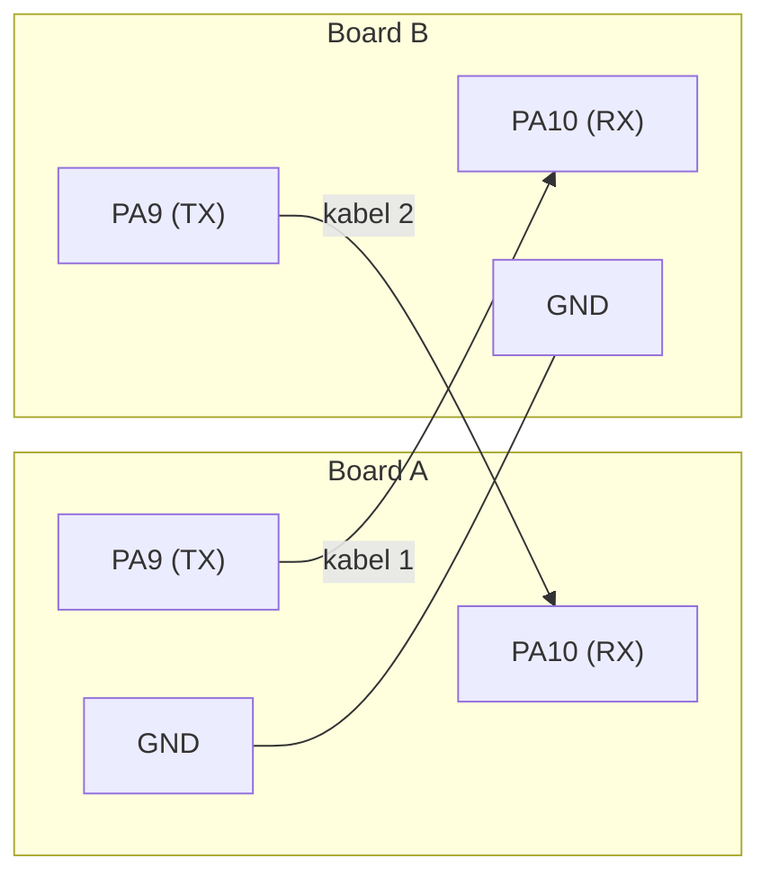

# Level 9: Dua Board Saling Terhubung

[← Level 8](08-uart-interrupt.md) · [Beranda](../README.md) · [Level 10: Protokol →](10-protokol.md)

> [!NOTE]
> Tujuan level ini: dua Blue Pill benar-benar saling bicara lewat UART, dua arah, dengan **firmware yang sama** di kedua board.

## Tujuan belajar

- [ ] Merakit sambungan UART dua board dengan benar (TX↔RX menyilang, GND bersama)
- [ ] Menjelaskan kenapa firmware simetris memudahkan debug
- [ ] Mengenali gejala kesalahan wiring dan baud rate
- [ ] Mengintip lalu lintas data dengan USB-TTL (*sniffing*)

**Prasyarat:** [Level 7](07-uart.md), [Level 8](08-uart-interrupt.md). Dua Blue Pill, dua tombol, dua LED.

---

## 🧠 Konsep

### 1. Wiring



| Kabel | Dari | Ke |
|---|---|---|
| 1 | TX (PA9) board A | RX (PA10) board B |
| 2 | TX (PA9) board B | RX (PA10) board A |
| 3 | GND board A | GND board B |

Setiap board juga membawa **tombol di PA0** dan **LED di PA8** (atau PA5 untuk tes awal), persis seperti di level sebelumnya.

> [!IMPORTANT]
> **Daya:** beri daya masing-masing board dari USB sendiri (atau dari ST-Link-nya sendiri). **Jangan** menyambungkan jalur 3,3 V atau 5 V antar board. Cukup TX, RX, dan GND.
>
> **Urutan:** nyalakan kedua board. Jika satu board mati sementara board lain mengirim, pin TX board yang menyala "mendorong" pin RX board yang mati dan dapat memberi daya samar lewat dioda proteksi. Itu bukan kerusakan, tetapi sumber perilaku aneh saat debug.

### 2. Firmware simetris

Karena kontrol berjalan **dua arah**, rancang satu firmware yang sama untuk kedua board:

```text
  Setiap board:
    - tombol lokal   →  event  →  KIRIM ke board lawan
    - UART RX        →  pesan  →  gerakkan LED LOKAL
```

Manfaatnya:

- cukup satu program untuk di-debug,
- jika A→B bekerja tetapi B→A tidak, kamu tahu masalahnya di wiring/perangkat keras, bukan di logika,
- pengujian dua arah tinggal menukar tombol yang ditekan.

### 3. Sniffing: mengintip jalur dengan USB-TTL

Sambungkan **RX USB-TTL** ke jalur TX salah satu board (paralel dengan RX board lawan), dan GND USB-TTL ke GND bersama. Terminal laptop sekarang menampilkan semua yang dikirim board itu, tanpa mengganggu komunikasi.

```text
Board A TX ───┬──────────► Board B RX
              └──────────► RX USB-TTL (hanya mendengarkan)
```

Ini cara tercepat membedakan "board A tidak mengirim" dari "board B tidak menerima".

### 4. Cek cepat dengan multimeter

Saat tidak ada transmisi, jalur UART **idle HIGH ≈ 3,3 V**. Ukur TX tiap board terhadap GND. Jika terbaca ≈ 0 V, board tidak menginisialisasi UART (atau pin salah).

---

## 🧪 Latihan

### 9A. Satu arah, paling sederhana

**Aturan:** board A mengirim karakter `X` tiap 1 detik (non-blocking). Board B menerima lewat interrupt (Level 8) dan **mengedipkan PC13 setiap kali menerima byte**.

**Hasil yang diharapkan:** PC13 board B berkedip tiap detik, sinkron dengan pengiriman A.

<details>
<summary>▶ Petunjuk: tidak ada yang terjadi di B</summary>

Cek dengan urutan: (1) GND tersambung? (2) TX A ke RX B (bukan TX ke TX)? (3) baud sama di kedua board? (4) sniff TX A: apakah `X` muncul di terminal? Lihat [troubleshooting](troubleshooting.md).

</details>

### 9B. Tombol A mengontrol LED B (satu arah)

**Aturan:** tombol A mengirim `1` saat ditekan dan `0` saat dilepas (pakai modul tombol Level 3, atau sederhana dengan deteksi tepi). LED B menyala selama `1` dan mati saat `0`.

**Hasil yang diharapkan:** LED B mengikuti tombol A secara real-time.

### 9C. Dua arah dengan firmware yang sama

**Aturan:** satu firmware untuk dua board: tombol lokal mengirim `1`/`0`, UART RX menyalakan/mematikan LED lokal. Flash firmware yang **sama persis** ke kedua board.

**Hasil yang diharapkan:** menekan tombol A menyalakan LED B, menekan tombol B menyalakan LED A. Tidak ada kode berbeda di dua board.

> [!TIP]
> Commit firmware ini dengan tag `level-09-symmetric`. Kamu akan kembali ke titik ini kalau integrasi P4 membingungkan.

### 9D. Latihan diagnosis (sengaja merusak)

Sengaja buat tiga kesalahan satu per satu, catat gejalanya, lalu perbaiki:

| Kesalahan yang dibuat | Gejala di board B | Cara kamu mendeteksinya |
|---|---|---|
| TX A ke TX B (bukan RX B) | | |
| Lepas kabel GND | | |
| Ubah baud salah satu board jadi 9600 | | |

<details>
<summary>▶ Perkiraan gejala (cocokkan dengan temuanmu)</summary>

- **TX ke TX:** tidak ada data diterima; pengukuran idle TX bisa tampak janggal.
- **GND dilepas:** tidak ada data, atau data acak/terputus-putus, kadang kadang berhasil saat tangan menyentuh kabel.
- **Baud mismatch:** data tiba tetapi berisi karakter sampah/salah.

Hasil nyatamu mungkin sedikit berbeda; catatan nyata lebih berharga daripada tebakan.

</details>

---

## ✅ Checkpoint: lulus jika

- [ ] A→B dan B→A bekerja bersamaan dengan firmware yang sama
- [ ] Mencabut GND membuat komunikasi gagal, dan kamu bisa menjelaskan kenapa
- [ ] Kamu bisa menunjukkan lewat sniffing bahwa data keluar dari board pengirim

## ❓ Cek pemahaman

**1.** Dua board, satu kabel TX A→RX B saja, tanpa kabel lain. Kenapa gagal?

**2.** Apa keuntungan utama firmware simetris saat debug?

**3.** Saat idle, berapa tegangan jalur TX yang sehat?

<details>
<summary>▶ Kunci jawaban (tulis jawabanmu dulu)</summary>

1. Tanpa GND bersama, kedua board tidak punya referensi tegangan yang sama; level yang dikirim tidak bisa ditafsirkan dengan benar.
2. Satu program, satu set bug. Kalau satu arah gagal tetapi arah lain jalan, pasti penyebabnya di wiring, bukan logika.
3. ≈ 3,3 V (idle HIGH).

</details>

---

[← Level 8](08-uart-interrupt.md) · [Beranda](../README.md) · [Level 10: Protokol →](10-protokol.md)
