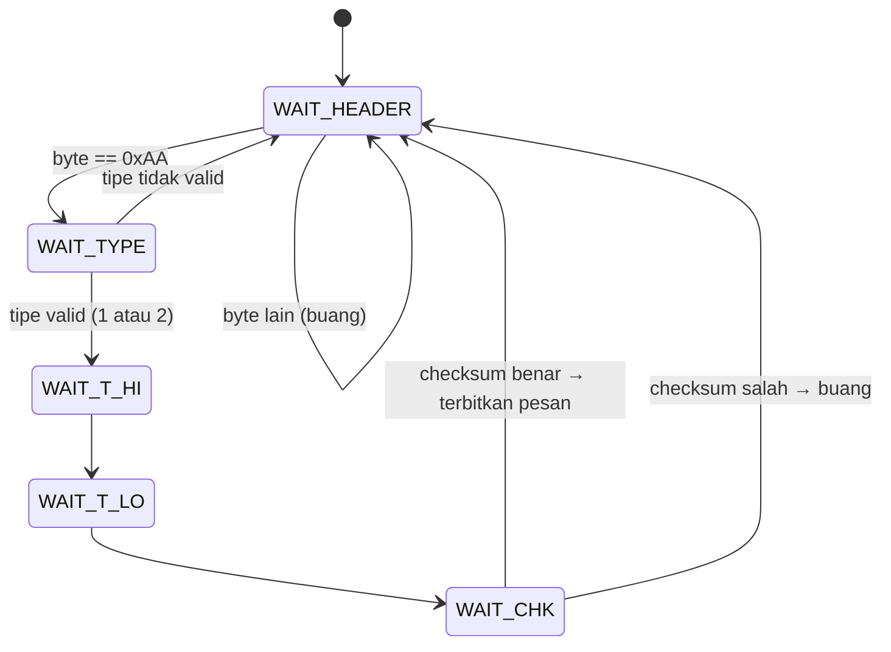

# Level 10: Merancang Protokol Pesan

[← Level 9](09-dua-board.md) · [Beranda](../README.md) · [Level 11: State Machine →](11-state-machine.md)

> [!NOTE]
> Tujuan level ini: merancang dan menguji **format pesan** (frame) yang membawa event KLIK/PRESS beserta durasi $T$ dengan andal. Dokumen P4 tidak menentukan formatnya, jadi ini **keputusan desainmu**.

## Tujuan belajar

- [ ] Menjelaskan kenapa UART butuh *framing*
- [ ] Membandingkan protokol teks dan biner, lalu memilih dengan alasan
- [ ] Menghitung checksum XOR dengan tangan
- [ ] Menulis parser berbasis state machine yang menolak frame rusak dan pulih sendiri
- [ ] Menguji parser di laptop dengan `gcc` sebelum di-flash

**Prasyarat:** [Level 8](08-uart-interrupt.md) (ring buffer, terima per byte).

---

## 🧠 Konsep

### 1. UART hanya aliran byte

UART tidak mengenal "pesan". Penerima hanya melihat deretan byte. Pertanyaan yang harus dijawab protokolmu:

| Pertanyaan | Mekanisme |
|---|---|
| **Di mana pesan mulai?** | byte header atau karakter awal |
| **Di mana pesan berakhir?** | panjang tetap, atau pembatas (mis. `\n`) |
| **Apakah isinya utuh?** | checksum atau CRC |
| **Bagaimana pulih setelah kerusakan?** | resync: cari header berikutnya, atau timeout |

### 2. Dua pendekatan

| | **Teks (ASCII)** | **Biner** |
|---|---|---|
| Contoh KLIK | `K\n` | `AA 01 00 00 01` |
| Contoh PRESS 1500 ms | `P1500\n` | `AA 02 05 DC DB` |
| Debug di terminal | **mudah** (bisa diketik dan dibaca) | perlu tampilan hex |
| Ukuran | variabel (2 sampai 8 byte) | tetap (5 byte) |
| Deteksi kerusakan | tidak ada kecuali kamu tambahkan | checksum terintegrasi |
| Parser | mengumpulkan sampai `\n`, lalu `strtoul` | state machine per byte |

Tidak ada yang "benar"; pilih lalu **tuliskan alasanmu**. Untuk belajar, protokol teks memudahkan debug awal; untuk keandalan, biner dengan checksum lebih tangguh.

### 3. Rancangan biner contoh (5 byte)

| Byte | Isi | Keterangan |
|---:|---|---|
| 0 | `0xAA` | header (penanda awal) |
| 1 | tipe | `0x01` = KLIK, `0x02` = PRESS |
| 2 | $T$ tinggi | byte atas dari $T$ (ms) |
| 3 | $T$ rendah | byte bawah dari $T$ (ms) |
| 4 | checksum | XOR byte 1 sampai 3 |

$T$ memakai 16 bit: rentang 0–65 535 ms (≈ 65 detik). **Apakah cukup untuk tugasmu?** Putuskan dan tuliskan konsekuensinya (misalnya: dibatasi/di-*clamp* ke 65 535).

### 4. Hitung checksum dengan tangan

XOR bekerja per bit: hasil 1 jika kedua bit berbeda.

**Contoh 1: PRESS selama 1500 ms.**

$$ 1500 = 5 \times 256 + 220 \Rightarrow \text{T tinggi} = 0x05,\ \text{T rendah} = 0xDC $$

$$ \text{chk} = 0x02 \oplus 0x05 \oplus 0xDC $$

$$ 0x02 \oplus 0x05 = 0x07 \qquad 0x07 \oplus 0xDC = 0xDB $$

Frame: `AA 02 05 DC DB`.

**Contoh 2: KLIK dengan $T = 300$ ms** ($300 = 0x012C$): $\text{chk} = 0x01 \oplus 0x01 \oplus 0x2C = 0x2C$. Frame: `AA 01 01 2C 2C`.

Penerima menghitung ulang XOR; jika tidak sama dengan byte checksum, frame **dibuang**.

### 5. Parser sebagai state machine

Penerima diberi makan **satu byte setiap kali**, dan menjaga state sendiri:



### 6. Keandalan: dua jebakan

> [!WARNING]
> **1. Header bisa muncul di dalam data.** $T = 0xAA00 = 43\,520$ ms memuat byte `0xAA` di tengah frame. Kalau parser kehilangan sinkron, ia bisa salah mengira itu header baru. Pertahanan: **checksum** (menolak frame palsu) dan **timeout antar-byte**.
>
> **2. Frame terpotong.** Jika setengah frame datang lalu kabel goyang, byte berikutnya diperlakukan sebagai kelanjutan. Pertahanan: jika jeda antar-byte melebihi ±50 ms, **reset parser ke WAIT_HEADER**.

Timeout dibuat dengan stempel waktu (pola Level 2): simpan `t_last_byte`, dan di `parser_feed` bandingkan `now - t_last_byte`.

### 7. Rancangan versi teks

Untuk protokol teks: kumpulkan karakter ke buffer baris sampai bertemu `\n`, lalu uraikan.

- Batasi panjang buffer (misalnya 16); jika terlampaui, buang seluruh baris.
- Tolak format tak dikenal; jangan menebak.

### 8. Tabel keputusanmu

Isi di catatan atau di `docs/protocol.md` repositorimu:

| Keputusan | Pilihanmu | Alasan |
|---|---|---|
| Teks atau biner? | | |
| Batas panjang T? | | |
| Header/pembatas apa? | | |
| Checksum apa? | | |
| Timeout antar-byte? | | |
| KLIK membawa T? | | |

---

## 🧩 Rancangan modul

```c
typedef enum { MSG_NONE = 0, MSG_KLIK, MSG_PRESS } MsgType;

typedef struct {
    MsgType  type;
    uint32_t t_ms;
} Message;

// Bangun frame untuk dikirim; kembalikan jumlah byte yang ditulis ke out.
uint8_t protocol_build(MsgType type, uint32_t t_ms, uint8_t *out);

// Beri makan satu byte; kembalikan 1 jika sebuah pesan utuh baru saja selesai.
int     protocol_feed(uint8_t byte, uint32_t now_ms, Message *msg);
```

Kerangka dan uji laptop: [`exercises/level-10-protocol/`](../exercises/level-10-protocol/).

---

## 🧪 Latihan

### 10A. Putuskan desain

Isi tabel keputusan (konsep 8) dengan alasanmu. Dua kalimat per baris cukup.

### 10B. `protocol_build`

**Aturan:** tulis fungsi yang membentuk frame dan menghitung checksum. Uji dengan angka-angka contoh: PRESS 1500 harus menghasilkan `AA 02 05 DC DB`, dan KLIK 300 harus menghasilkan `AA 01 01 2C 2C`.

### 10C. `protocol_feed`

**Aturan:** tulis parser state machine di atas. Perhatikan timeout antar-byte.

<details>
<summary>▶ Petunjuk 1: struktur data</summary>

Simpan state parser, jumlah byte yang sudah masuk, nilai sementara `type`, `t_hi`, `t_lo`, dan `t_last_byte` dalam variabel `static` di dalam `protocol.c`.

</details>

<details>
<summary>▶ Petunjuk 2: ketika checksum salah, apa yang dilakukan dengan byte header yang mungkin ada di dalam frame yang dibuang?</summary>

Kasus sederhana: kembali ke WAIT_HEADER dan lanjutkan dengan byte berikutnya. Kasus lebih tangguh (opsional): periksa apakah byte yang baru dibuang bisa jadi awal frame sah, dan mulai ulang parser darinya. Tuliskan alasan kalau kamu memilih salah satunya.

</details>

### 10D. Uji di laptop dengan `gcc`

**Aturan:** lengkapi `test_protocol.c` dengan kasus-kasus:

| # | Masukan | Harus menghasilkan |
|--:|---|---|
| 1 | frame PRESS 1500 yang benar | `MSG_PRESS`, `t_ms = 1500` |
| 2 | frame KLIK yang benar | `MSG_KLIK` |
| 3 | frame dengan checksum salah | tidak ada pesan |
| 4 | sampah acak lalu frame benar | pesan benar tetap terbit |
| 5 | frame terpotong, jeda > 50 ms, lalu frame benar | pesan benar tetap terbit |
| 6 | dua frame berurutan tanpa jeda | dua pesan |

```bash
cd exercises/level-10-protocol
gcc -Wall -Wextra -o test_protocol test_protocol.c protocol.c && ./test_protocol
```

> [!TIP]
> Menguji di laptop jauh lebih cepat daripada flash berulang: kamu mendapat hasil dalam detik, dan bisa memberi masukan yang mustahil dibuat dengan tangan (frame setengah jalan, sampah acak).

### 10E. Uji di board lewat UART

**Aturan:** board A mengirim satu frame tiap 2 detik dengan nilai yang berganti-ganti (KLIK, PRESS 1500, PRESS 3000). Board B mem-parsing, lalu mengirim hasilnya ke USB-TTL/terminal, misalnya `RX: PRESS T=1500`.

**Hasil yang diharapkan:** terminal menampilkan jenis dan $T$ yang tepat.

### 10F. Fuzz sederhana

**Aturan:** dari terminal laptop, ketik karakter acak (atau tempel teks panjang) ke RX board B yang sedang berjalan, lalu kirim frame sah dari board A.

**Hasil yang diharapkan:** frame sah tetap diterima setelah sampah, dan board tidak hang.

---

## ✅ Checkpoint: lulus jika

- [ ] Kasus 1–6 di `test_protocol` lolos
- [ ] Frame contoh PRESS 1500 = `AA 02 05 DC DB`
- [ ] Parser menolak checksum salah dan pulih setelah sampah
- [ ] Tabel keputusanmu terisi dengan alasan

## ❓ Cek pemahaman

**1.** Hitung checksum untuk PRESS selama 2000 ms.

**2.** Kenapa checksum tidak cukup tanpa timeout antar-byte?

**3.** Kenapa UART tidak menjamin batas pesan?

<details>
<summary>▶ Kunci jawaban (tulis jawabanmu dulu)</summary>

1. $2000 = 0x07D0$ (T tinggi 0x07, T rendah 0xD0). $\text{chk} = 0x02 \oplus 0x07 \oplus 0xD0 = 0x05 \oplus 0xD0 = 0xD5$. Frame: `AA 02 07 D0 D5`.
2. Frame yang terpotong lalu disambung frame berikutnya mungkin kebetulan menghasilkan checksum yang lolos, atau parser menunggu byte yang tidak akan datang. Timeout memastikan parser tidak terjebak menunggu selamanya dan memulai dari awal.
3. UART hanya mengirim byte satu per satu; ia tidak punya konsep "pesan", jadi pesan harus dibatasi oleh header/panjang/pembatas buatan kita.

</details>

---

[← Level 9](09-dua-board.md) · [Beranda](../README.md) · [Level 11: State Machine →](11-state-machine.md)
