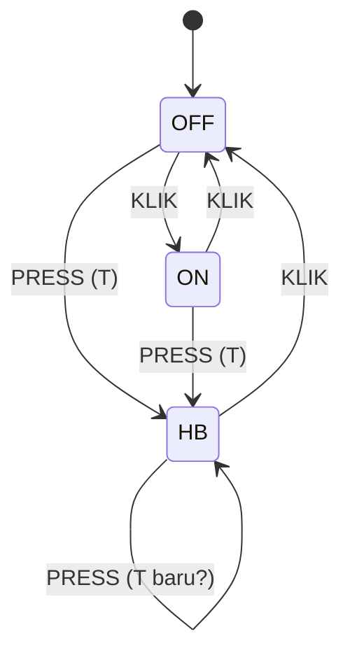

# Level 11: State Machine LED

[← Level 10](10-protokol.md) · [Beranda](../README.md) · [Level 12: Integrasi P4 →](12-integrasi-p4.md)

> [!NOTE]
> Tujuan level ini: menulis logika inti P4, yaitu perilaku LED (OFF/ON/HB) menurut tabel transisi, dan mengujinya **pada satu board saja** sebelum UART ikut campur.

## Tujuan belajar

- [ ] Menjelaskan state, event, transisi, dan aksi
- [ ] Menerjemahkan tabel transisi P4 menjadi kode `switch`
- [ ] Memisahkan "menangani event" dari "kerja berulang"
- [ ] Mengidentifikasi dan mengonfirmasi ambiguitas spesifikasi

**Prasyarat:** [Level 3](03-event-tombol.md) (event tombol), [Level 5](05-heartbeat.md) (heartbeat), [Level 4](04-pwm.md) (kecerahan).

---

## 🧠 Konsep

### 1. Apa itu state machine

State machine (FSM) adalah cara menulis "sistem ini punya beberapa **kondisi**, dan setiap **kejadian** membawanya ke kondisi lain". Empat istilah:

| Istilah | Arti | Di P4 |
|---|---|---|
| **State** | kondisi saat ini | `OFF`, `ON`, `HB` |
| **Event** | sesuatu yang terjadi | `KLIK`, `PRESS` |
| **Transisi** | perpindahan state akibat event | `OFF + KLIK → ON` |
| **Aksi** | pekerjaan yang dilakukan saat transisi atau di dalam state | nyalakan LED, mulai heartbeat |



### 2. Tabel transisi dari dokumen P4

| State awal | Event | State tujuan | Aksi |
|---|---|---|---|
| OFF | KLIK | ON | LED penuh |
| ON | KLIK | OFF | LED mati |
| OFF | PRESS | HB | mulai heartbeat |
| ON | PRESS | HB | mulai heartbeat |
| HB | KLIK | OFF | hentikan heartbeat, LED mati |
| HB | PRESS | HB | (tetap di HB) |

Tabel ini lengkap: 3 state × 2 event = 6 sel, semuanya terisi. Selalu periksa kelengkapan seperti ini. Sel kosong adalah bug yang menunggu.

### 3. Dua jenis kerja

| Jenis | Kapan | Contoh |
|---|---|---|
| **Aksi saat event** (*entry action*) | sekali, ketika transisi terjadi | `OFF → ON`: set kecerahan 100% |
| **Kerja berulang** | terus-menerus selama di state itu | `HB`: perbarui kecerahan sesuai fase |

Maka struktur kode yang bersih punya **dua fungsi**:

```c
void led_handle_event(Event ev, uint32_t T_ms);   // dipanggil sekali per event
void led_update(uint32_t now_ms);                 // dipanggil tiap putaran loop
```

### 4. Kerangka dengan `switch`

```c
typedef enum { LED_OFF, LED_ON, LED_HB } LedState;
typedef enum { EV_NONE, EV_KLIK, EV_PRESS } Event;

static LedState state = LED_OFF;

void led_handle_event(Event ev, uint32_t T_ms)
{
    switch (state)
    {
        case LED_OFF:
            /* KLIK → ? PRESS → ? */
            break;
        case LED_ON:
            /* ... */
            break;
        case LED_HB:
            /* ... */
            break;
    }
}
```

Pola ini disebut *state-centric*: `switch` pada state, lalu `if` pada event. Alternatifnya adalah *table-driven* (tabel array transisi), yang lebih rapi untuk FSM besar (lihat latihan opsional).

### 5. Dua ambiguitas yang harus kamu putuskan

Spesifikasi manusia hampir selalu punya celah. Temukan dan konfirmasi:

> [!IMPORTANT]
> **Ambiguitas 1: kapan T diketahui?**
> PRESS didefinisikan sebagai tombol ditahan $T > 1$ s, dan heartbeat berjalan dengan periode $T$. Tetapi $T$ (durasi tekan) baru **diketahui saat tombol dilepas**. Konsekuensinya: HB baru **mulai saat tombol dilepas**, bukan saat tekanan melewati 1 detik. Konfirmasi ke pemateri bahwa itu maksudnya.
>
> **Ambiguitas 2: `HB + PRESS`.**
> Tabel hanya menulis "tetap di HB". Apakah periodenya **diganti** dengan T yang baru, atau periode lama dipertahankan? Pilihan paling alami: diganti. Konfirmasi, dan tuliskan keputusan di README P4-mu.

Kebiasaan penting: **jangan diam-diam memilih**. Tuliskan asumsimu agar penilai tahu itu keputusan sadar.

### 6. Aturan penempatan

- FSM **hanya dijalankan dari `main` loop**, bukan dari ISR. ISR hanya menghasilkan event (flag/antrean), `main` yang memanggil `led_handle_event`.
- Tidak ada `HAL_Delay` di dalam FSM.
- Saat keluar dari HB, panggil `heartbeat_stop()` (yang membuat kecerahan 0), jangan biarkan di nilai terakhir.

---

## 🧩 Rancangan modul

```c
void led_init(void);                             // state awal OFF, kecerahan 0
void led_handle_event(Event ev, uint32_t T_ms);  // ubah state sesuai tabel
void led_update(uint32_t now_ms);                // kerja berulang (HB)
LedState led_get_state(void);                    // untuk debug/log
```

Kerangka: [`exercises/level-11-led-fsm/`](../exercises/level-11-led-fsm/).

---

## 🧪 Latihan

### 11A. Implementasikan FSM

**Aturan:** terjemahkan tabel transisi menjadi `led_handle_event` dan `led_update`, memakai `led_set_brightness` (Level 4) dan `heartbeat_*` (Level 5).

### 11B. Sambungkan ke tombol lokal (tanpa UART)

**Aturan:** event dari modul tombol (Level 3) langsung masuk `led_handle_event` pada **satu board**:

```c
uint32_t T;
ButtonEvent be = button_poll(&T);
if (be == BTN_EVT_KLIK)  led_handle_event(EV_KLIK,  T);
if (be == BTN_EVT_PRESS) led_handle_event(EV_PRESS, T);
led_update(HAL_GetTick());
```

**Hasil yang diharapkan:** LED lokal mengikuti perilaku P4 dari tombol lokal.

### 11C. Skenario uji (6 transisi)

Jalankan berurutan dan isi kolom hasil:

| # | Aksi | State sebelum | Hasil yang diharapkan | Lolos? |
|--:|---|---|---|---|
| 1 | KLIK | OFF | ON (LED penuh) | |
| 2 | KLIK | ON | OFF (mati) | |
| 3 | PRESS 1,5 s | OFF | HB, periode ≈ 1,5 s | |
| 4 | KLIK | HB | OFF (mati) | |
| 5 | KLIK lalu PRESS 2 s | ON | HB, periode ≈ 2 s | |
| 6 | PRESS 3 s | HB | tetap HB, periode ≈ 3 s | |

### 11D. Log transisi lewat UART (debug)

**Aturan:** setiap kali state berubah, kirim satu baris ke USB-TTL: `OFF -> ON (KLIK)`. Gunakan `snprintf` + `HAL_UART_Transmit` yang pendek. Log ini sangat berharga saat integrasi.

### 11E. Opsional: versi table-driven

**Aturan:** ubah `switch` menjadi tabel dua dimensi `next_state[state][event]`, plus fungsi aksi. Bandingkan keterbacaan kedua versi.

---

## ✅ Checkpoint: lulus jika

- [ ] Keenam skenario 11C lolos pada satu board
- [ ] Tidak ada `HAL_Delay` di FSM
- [ ] Kamu bisa menjelaskan dua ambiguitas dan keputusanmu

## ❓ Cek pemahaman

**1.** Kenapa FSM tidak boleh dipanggil dari dalam `HAL_GPIO_EXTI_Callback`?

**2.** Apa beda `led_handle_event` dan `led_update`?

**3.** State HB, event KLIK. Apa yang harus terjadi pada kecerahan LED?

<details>
<summary>▶ Kunci jawaban (tulis jawabanmu dulu)</summary>

1. Callback ISR harus singkat dan tidak boleh membawa logika berat atau memanggil fungsi yang mungkin menunggu. ISR cukup menghasilkan event; `main` yang memprosesnya.
2. `led_handle_event` dijalankan **sekali** per event dan mengubah state. `led_update` dijalankan **tiap putaran** untuk pekerjaan yang bergantung waktu (animasi HB).
3. Kecerahan harus menjadi 0 dan heartbeat berhenti (state → OFF).

</details>

---

[← Level 10](10-protokol.md) · [Beranda](../README.md) · [Level 12: Integrasi P4 →](12-integrasi-p4.md)
