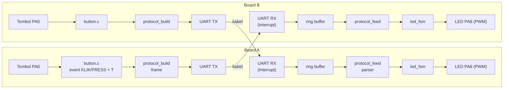
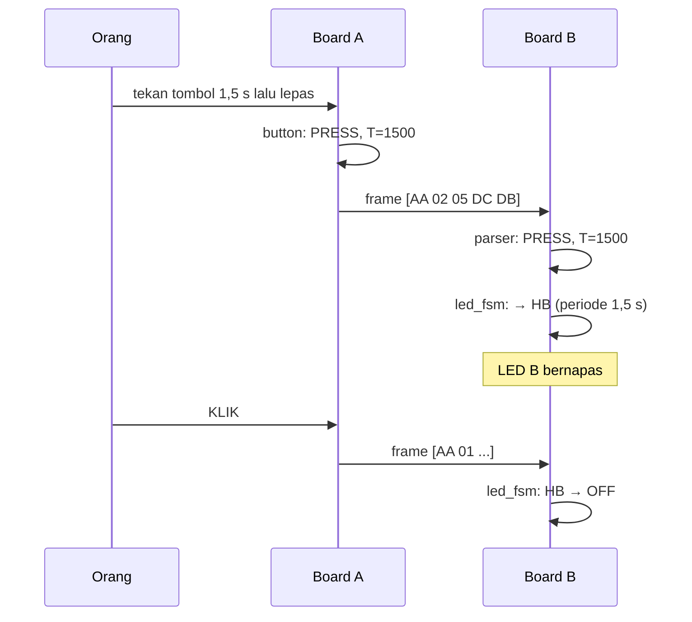
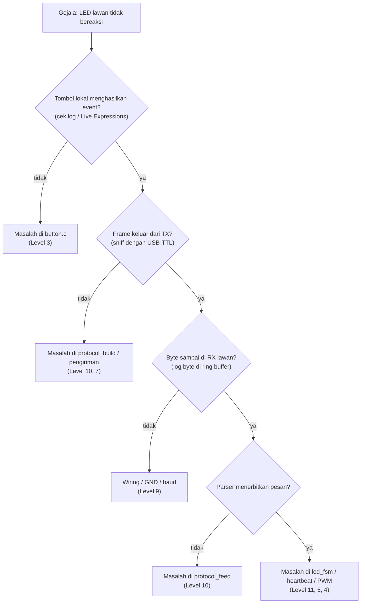

# Level 12: Integrasi, yaitu P4 Itu Sendiri

[← Level 11](11-state-machine.md) · [Beranda](../README.md)

> [!NOTE]
> Semua bagian sudah ada dan sudah diuji sendiri-sendiri. Level ini hanya **menyambungkannya**. Panduannya berupa rencana bertahap, bukan kode jadi.

## Tujuan belajar

- [ ] Merakit modul button, protokol, UART, dan LED FSM menjadi satu firmware
- [ ] Menguji sistematis dengan matriks uji dua arah
- [ ] Menguji ketahanan (frame rusak, kabel dicabut)
- [ ] Mendokumentasikan keputusan desain

**Prasyarat:** Level 3, 5, 8, 9, 10, 11 lolos checkpoint masing-masing.

---

## 🏗️ Arsitektur



Satu jalur per arah. Pada setiap board ada **dua aliran independen**: aliran *keluar* (tombol lokal → UART TX) dan aliran *masuk* (UART RX → LED lokal).



Perhatikan: **LED lokal tidak bereaksi pada tombol lokal.** Sesuai dokumen: tombol satu STM mengontrol LED STM **lainnya**.

---

## 📋 Peran tiap modul

| Modul | Tugas | Dari level |
|---|---|---|
| `button.c/.h` | menghasilkan KLIK/PRESS + T dari EXTI | 3 |
| `ringbuf.c/.h` | menampung byte UART masuk | 8 |
| `protocol.c/.h` | membangun frame dan mem-parsing | 10 |
| `led.c/.h` | PWM dan kecerahan | 4 |
| `heartbeat.c/.h` | animasi HB (linear, opsional Gaussian) | 5, 6 |
| `led_fsm.c/.h` | state machine LED | 11 |
| `main.c` | hanya merangkai: `init` + super-loop | 12 |

---

## 🔁 Kerangka super-loop

Bukan kode jadi. Isi bagian `...` sendiri:

```c
/* USER CODE BEGIN 2 */
HAL_TIM_PWM_Start(&htim1, TIM_CHANNEL_1);
HAL_UART_Receive_IT(&huart1, &rx_byte, 1);
led_init();
/* USER CODE END 2 */

while (1)
{
    uint32_t now = HAL_GetTick();

    /* 1) Tombol lokal → kirim ke board lawan */
    uint32_t T;
    ButtonEvent be = button_poll(&T);
    if (be != BTN_EVT_NONE) {
        /* bangun frame, kirim lewat HAL_UART_Transmit */
    }

    /* 2) Byte masuk → parser → LED lokal */
    uint8_t b;
    while (rb_pop(&rx_rb, &b) == 0) {
        Message m;
        if (protocol_feed(b, now, &m)) {
            /* panggil led_handle_event sesuai m */
        }
    }

    /* 3) Kerja berulang */
    led_update(now);
}
```

### Aturan emas integrasi

> [!IMPORTANT]
> 1. **Tidak ada `HAL_Delay`** di jalur utama.
> 2. **ISR/callback hanya** mencatat waktu, mengisi ring buffer, atau set flag.
> 3. **FSM dan parser hanya dipanggil dari `main`.**
> 4. Pengiriman frame 5 byte (≈ 434 µs pada 115200) dengan `HAL_UART_Transmit` blocking dari `main` dapat diterima. Jangan dari ISR.
> 5. Prioritas NVIC: pastikan SysTick tidak lebih rendah daripada interrupt yang memanggil fungsi berbasis tick. Cukup jangan memanggil `HAL_Delay` di ISR.

---

## 🪜 Urutan bring-up (naik satu anak tangga setiap kali)

Jangan langsung menguji semuanya. Naik bertahap, dan **jangan lanjut sebelum tahap sebelumnya lolos**.

| Tahap | Apa yang diuji | Lolos jika |
|--:|---|---|
| 1 | Satu arah, hanya KLIK: A→B | KLIK di A menyalakan/mematikan LED B |
| 2 | Satu arah, KLIK + PRESS dengan T | PRESS di A memulai HB di B dengan periode benar |
| 3 | Transisi lengkap A→B | keenam transisi sesuai tabel |
| 4 | Dua arah (firmware sama) | B→A bekerja dengan perilaku sama |
| 5 | Ketahanan | lihat matriks uji ketahanan |
| 6 | Bonus Gaussian | `#define` mengganti kurva |

---

## 🧪 Matriks uji

### Fungsional (ulangi untuk A→B **dan** B→A)

| # | Aksi di pengirim | State LED penerima sebelum | Hasil yang diharapkan | A→B | B→A |
|--:|---|---|---|:-:|:-:|
| 1 | KLIK | OFF | ON | | |
| 2 | KLIK | ON | OFF | | |
| 3 | PRESS 1,5 s | OFF | HB ≈ 1,5 s | | |
| 4 | PRESS 2 s | ON | HB ≈ 2 s | | |
| 5 | KLIK | HB | OFF | | |
| 6 | PRESS 3 s | HB | HB ≈ 3 s (periode baru) | | |

### Ketahanan

| # | Uji | Hasil yang diharapkan | Lolos? |
|--:|---|---|:-:|
| 1 | Cabut kabel TX saat HB lalu pasang kembali | board tidak hang; kontrol pulih | |
| 2 | Kirim sampah dari terminal ke RX | state LED tidak berubah sembarangan | |
| 3 | Tekan tombol sangat cepat berulang (spam) | tidak crash; tidak ada event ganda | |
| 4 | Reset salah satu board saat yang lain HB | board reset mulai dari OFF; board lain tidak terpengaruh | |
| 5 | Biarkan 10 menit | tidak ada drift atau hang | |

---

## 🐛 Diagnosa terstruktur

Jika sesuatu tidak jalan, **persempit lokasi** dengan urutan ini:



Tiap kotak mengarah ke level yang sudah kamu kuasai. Itulah gunanya jalur latihan bertahap.

---

## 📝 Dokumentasi untuk pengumpulan

Tulis `README.md` untuk repositori P4-mu dengan isi:

- [ ] Ringkasan sistem + diagram (boleh Mermaid seperti di atas)
- [ ] Peta pin dan skema wiring
- [ ] Desain protokol (format frame, checksum, timeout) dan **alasannya**
- [ ] Keputusan atas ambiguitas (kapan T diketahui, perilaku HB + PRESS)
- [ ] Hasil matriks uji
- [ ] Batasan yang kamu ketahui (misalnya T maksimum, event cepat beruntun)
- [ ] (Bonus) Penjelasan kurva Gaussian dan pemilihan σ

---

## ✅ Definisi selesai (*definition of done*)

- [ ] Keenam transisi lolos A→B dan B→A
- [ ] Tidak ada `HAL_Delay` di jalur utama
- [ ] Parser menolak frame rusak dan pulih sendiri
- [ ] Periode HB cocok dengan durasi tekan (±5%)
- [ ] Dokumentasi menjelaskan keputusan desain
- [ ] Kamu bisa menjelaskan setiap modul tanpa melihat kode

---

[← Level 11](11-state-machine.md) · [Beranda](../README.md)
