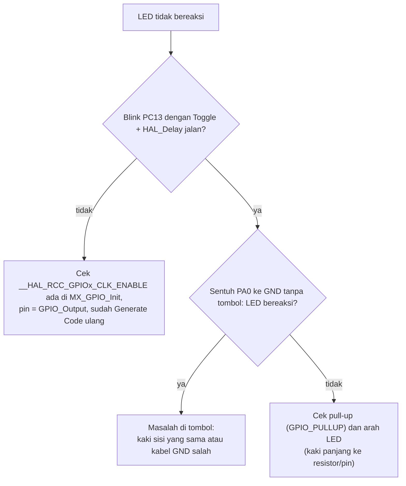
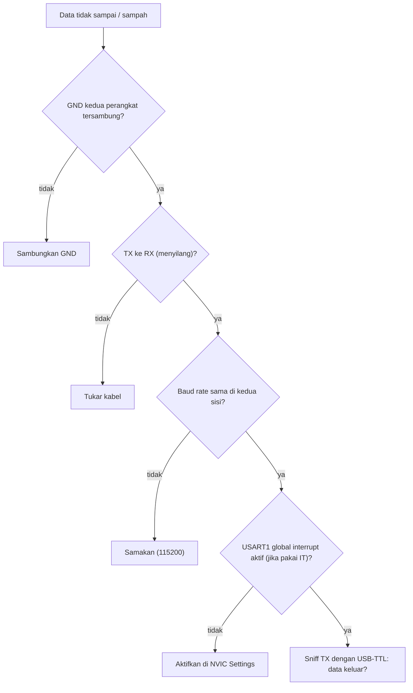

# Troubleshooting

[← Beranda](../README.md)

Cara memakai halaman ini: temukan **gejala**, jalankan **pemeriksaan berurutan**, dan **berhenti di langkah pertama yang gagal**. Jangan melompat.

## 1. Build dan flash

| Gejala | Periksa |
|---|---|
| `No ST-LINK detected` | kabel SWDIO/SWCLK/GND/3,3 V; USB ST-Link; driver; kabel data (bukan kabel charge-only) |
| Flash berhasil tapi program tidak jalan | jumper **BOOT0 = 0**; tekan reset; periksa clock (HSE) |
| Tidak bisa flash setelah Generate Code | SYS Debug mungkin ter-set *No Debug*; set ke *Serial Wire*. Pemulihan lewat BOOT0 dan tombol reset |
| Error `undefined reference` | file `.c` belum di dalam folder `Core/Src`, atau tidak ikut ter-build |
| Kodemu hilang setelah Generate Code | kode ada di luar blok `USER CODE BEGIN/END` |

## 2. LED tidak menyala (GPIO)

| Gejala | Penyebab paling mungkin |
|---|---|
| LED eksternal langsung menyala tanpa kode | PC13 terhubung ke LED eksternal (HIGH → menyala); atau PA0 floating |
| Logika terbalik | ditekan = LOW (pull-up); LED bawaan active-low |
| LED menyala redup | pin di-toggle terlalu cepat (efek PWM tak sengaja), lihat Level 1B |

## 3. Tombol

| Gejala | Penyebab |
|---|---|
| Satu tekanan = banyak event | bouncing; debounce belum benar (Level 3) |
| Callback EXTI tidak terpanggil | EXTI line tidak di-enable di NVIC, atau mode pin bukan External Interrupt |
| Durasi aneh | `now - t_press` terbalik; `t_press` tak disimpan saat tepi turun |
| Berhenti merespons setelah satu event | flag tidak dikosongkan di `main` |

## 4. PWM

| Gejala | Penyebab |
|---|---|
| LED selalu mati | belum `HAL_TIM_PWM_Start`; PA8 belum `TIM1_CH1`; LED masih di PA5 |
| Tidak pernah benar-benar penuh | CCR maksimum = ARR, seharusnya ARR + 1 |
| LED berkedip terlihat | frekuensi PWM terlalu rendah (ARR terlalu besar) |
| Heartbeat tersentak | pembagian integer terlalu dini; `t0` tidak di-reset saat ganti T |

## 5. UART

| Gejala | Penyebab |
|---|---|
| Karakter sampah | baud tidak sama; clock salah |
| Tidak ada data | TX/RX tidak menyilang; GND tidak tersambung |
| `permission denied` (Linux) | `sudo usermod -aG dialout $USER`, lalu login ulang |
| Hanya satu byte diterima | tidak memasang ulang `HAL_UART_Receive_IT` di callback |
| Berhenti menerima setelah error | overrun; pasang ulang di `HAL_UART_ErrorCallback` |
| `HAL_BUSY` pada `Transmit_IT` | transmisi sebelumnya belum selesai |

## 6. Integrasi

Pakai diagram diagnosa di [Level 12](12-integrasi-p4.md#-diagnosa-terstruktur): tombol → frame keluar → byte sampai → parser → LED.

## 7. Kebiasaan debug yang menghemat waktu

- **Kecilkan masalahnya.** Uji satu modul sendirian.
- **Tulis prediksi** sebelum menjalankan.
- **Log lewat UART** (satu baris per event) dan **Live Expressions** untuk variabel.
- **Sniff** jalur dengan USB-TTL.
- **Commit versi yang jalan**, supaya bisa kembali.
